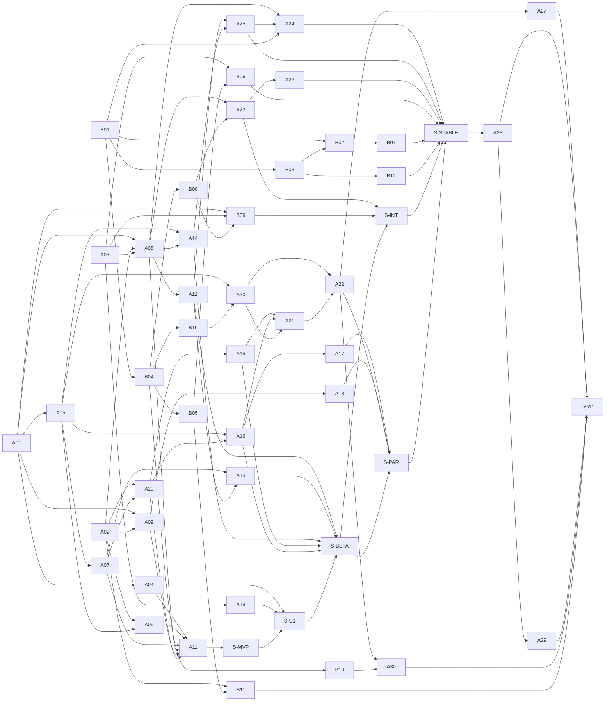

# WECOMMANDER V2 — Bağımlılık Matrisi

- **Sürüm:** v0.2 · **Tarih:** 2026-11-07
- **Kaynak:** [`plans/data/wecommander_v2_work_packages.json`](./data/wecommander_v2_work_packages.json): 43 iş paketi ve 7 stabilizasyon dönemi. Bu belgedeki tablolar [`wecommander_v2_scheduler.py`](./tools/wecommander_v2_scheduler.py) ile üretilir.
- **İlgili:** [Master Plan](./WECOMMANDER_V2_MASTER_PLAN.md) · [Takvim](./WECOMMANDER_V2_DEVELOPMENT_CALENDAR.md) · [Sürüm kriterleri](./WECOMMANDER_V2_RELEASE_CRITERIA.md)

## 1. Kurallar

1. **Ön koşul**, bağımlı kalemin başlaması için tamamlanmış (merge edilmiş, CI yeşil) olmalıdır.
2. `S-*` kalemleri stabilizasyon dönemleridir ve yeni özellik içermez.
3. Bağımlılık değişikliği yalnız veri dosyasında yapılır; ardından `render --write` çalıştırılır. Araç döngüsel ve eksik bağımlılıkları reddeder.
4. **Agent Mode güvenlik sırası değiştirilemez:**
   - B01 her senaryoda ilk iştir.
   - B03, B01'e bağlıdır.
   - v1.0 (B02), B01 ve B03 olmadan etiketlenmez.
   - AI ile ilgili User Mode özelliği (A24) B01'e bağlıdır.
5. **User Mode 1.0 Stable (S-U1)**; senkronizasyona (A20, B10), ekip özelliklerine (A22), AI'a (A24) ve mobile (A28, A29) bağlı olamaz. Bu kural testle denetlenir.

## 2. v0.2'de değişen bağımlılıklar

| Kalem | v0.1 | v0.2 | Neden |
|---|---|---|---|
| B03 | — | B01 | Aynı onay yüzeyi; durum makinesi B01'in onay bağlamasını kullanır |
| B12 | B03 | B03 (+ health_snapshot işi B12'ye taşındı) | B03 artık yalnız işlem durum makinesi |
| A19 | M3 kapsamı | U1 kapsamı; S-U1 A19'a bağlı | Temel terminal ayarları U1 için zorunlu |
| S-U1 | yoktu | S-MVP, A19, A04 | Yeni kilometre taşı |
| S-BETA | S-MVP, A12–A16, A19, A04 | S-U1, A12–A16 | Genişletilmiş Beta, U1'den sonra |
| A09 | A08 (v0.1 ilk taslak) | A01, A02 | SFTP çekirdeği sekme yönetimini beklemez (v0.1 hesaplamasında zaten böyleydi) |

## 3. Bağımlılık matrisi

"Aynı anda çalışan" sütunu S2 takvimindeki çakışmaları gösterir; bunlar paralel yürütülebilir.

<!-- GENERATED:BEGIN dep-matrix -->
| Kalem | Ad | Doğrudan ön koşullar | Doğrudan bağımlılar | Tüm ön koşullar | S2'de aynı anda çalışan |
|---|---|---|---|---|---|
| B01 | AI terminal_input yetkilendirme düzeltmesi | — | A24, B02, B03, B04 | 0 | A01 |
| B02 | Production kabul kapanışı (v1.0 / A4 / A7 / A8) | B01, B03 | B07 | 2 | A02 |
| B03 | Onaylı işlem durum makinesi ve teslimat güvencesi | B01 | B02, B12 | 1 | A01, A02 |
| B04 | MFA (TOTP + WebAuthn) ve yeniden doğrulama | B01 | B05, B08, B10, B13 | 1 | A02, A03 |
| B05 | İnsan terminali akışı (gateway + ajan) | B04 | B06, B11 | 2 | A12, B12 |
| B06 | Web panelinde gerçek terminal | B05, A03 | S-STABLE | 4 | A12, A13 |
| B07 | Regresyon test paketi ve sürüm adayı kontrol listesi | B02 | S-STABLE | 3 | A11, S-MVP |
| B08 | Masaüstü oturum açma ve SSH eşleştirme uçları | B04 | A23, B09 | 2 | A17 |
| B09 | Masaüstünde Agent çalışma alanı | B08, A01, A03 | S-INT | 5 | A23 |
| B10 | Uçtan uca şifreli senkronizasyon sunucusu | B04 | A20 | 2 | A18, A26 |
| B11 | Bastion SSH (Agent Mode) | A02, B05 | S-M7 | 4 | A28, A29 |
| B12 | v1.2 gözlem işleri ve health_snapshot gürültüsü | B03 | S-STABLE | 2 | B05, S-U1 |
| B13 | OIDC SSO | B04 | A30 | 2 | A27, A28 |
| A01 | Desktop uygulama iskeleti ve depo yapısı (G1) | — | A04, A05, A08, A09, B09 | 0 | B01, B03 |
| A02 | SSH çekirdeği wc-ssh-core (G2) | — | A06, A08, A09, A10, B11 | 0 | B02, B03, B04 |
| A03 | Terminal arayüz paketi (G3) | — | A08, A19, B06, B09 | 0 | A05, B04 |
| A04 | Paketleme, dağıtım ve otomatik güncelleme | A01 | A11, S-U1 | 1 | A06, A07 |
| A05 | Yerel kasa (wc-vault) ve anahtar yönetimi | A01 | A06, A07, A14, A16, A20 | 1 | A03, A08 |
| A06 | Host key doğrulaması ve known_hosts | A02, A05 | A11 | 3 | A04, A09 |
| A07 | Hosts, Groups, Tags, profiller, ssh_config | A05 | A10, A11, A13 | 2 | A04, A08 |
| A08 | Terminal sekmeleri ve oturum yönetimi | A01, A02, A03 | A11, A12, A14, A23, A24 | 3 | A05, A07 |
| A09 | SFTP dosya yöneticisi | A01, A02 | A11, A18 | 2 | A06, A10 |
| A10 | Jump Host ve Local Port Forwarding | A02, A07 | A11, A15, A16 | 4 | A09 |
| A11 | MVP güvenlik incelemesi, gerçek cihaz kabulü ve kullanıcı belgeleri | A04, A06, A07, A08, A09, A10 | S-MVP | 10 | A19, B07 |
| A12 | Split View ve güvenli Broadcast | A08 | A13, A25, S-BETA | 4 | B05, B06 |
| A13 | Workspaces ve oturum geri yükleme | A12, A07 | S-BETA | 7 | A15, B06 |
| A14 | Snippets, komut geçmişi, autocomplete | A08, A05 | A25, S-BETA | 5 | A15, A16 |
| A15 | Remote Forward, SOCKS ve proxy | A10 | A21, S-BETA | 5 | A13, A14 |
| A16 | Agent Forwarding ve SSH sertifikaları | A05, A10 | A17, A21, S-BETA | 5 | A14 |
| A17 | FIDO2 / donanım anahtarı | A16 | S-PAR | 6 | B08, S-BETA |
| A18 | SCP | A09 | S-PAR | 3 | B10, S-INT |
| A19 | Tema, font, kısayollar, terminal arama, ayarlar | A03 | S-U1 | 1 | A11 |
| A20 | Uçtan uca şifreli kişisel senkronizasyon (istemci) | A05, B10 | A21, A22 | 5 | A24, A25, A26 |
| A21 | Bağımsız güvenlik ve kriptografi incelemesi | A20, A16, A15 | A22 | 11 | A24 |
| A22 | Ekip özellikleri (kasa, hostlar, çalışma alanları, RBAC, denetim) | A20, A21 | A27, A30, S-PAR | 12 | A24 |
| A23 | SSH'tan Agent Mode'a yükseltme | B08, A08 | A26, S-INT | 7 | B09 |
| A24 | Kontrollü AI asistanı (kullanıcının kendi anahtarı) | A25, A08, B01 | S-STABLE | 9 | A20, A21, A22 |
| A25 | Komut risk değerlendirmesi | A12, A14 | A24, S-STABLE | 7 | A20 |
| A26 | Gelişmiş operasyon araçları | A23 | S-STABLE | 8 | A20, B10 |
| A27 | Ortak terminal oturumu (Multiplayer, tek yazar) | A22 | S-M7 | 13 | B13, S-PAR, S-STABLE |
| A28 | Android | S-STABLE | A29, S-M7 | 43 | A30, B11, B13 |
| A29 | iOS | A28 | S-M7 | 44 | B11 |
| A30 | Kurumsal politikalar | A22, B13 | S-M7 | 14 | A28 |
| S-BETA | Genişletilmiş özellik Beta stabilizasyonu | S-U1, A12, A13, A14, A15, A16 | S-INT, S-PAR | 19 | A17 |
| S-INT | Agent Mode entegrasyon stabilizasyonu | B09, A23, S-BETA | S-STABLE | 25 | A18 |
| S-M7 | M7 stabilizasyonu | A27, A28, A29, A30, B11 | — | 49 | — |
| S-MVP | MVP stabilizasyonu | A11 | S-U1 | 11 | B07 |
| S-PAR | Termius eşitliği stabilizasyonu | A17, A18, A22, S-BETA | S-STABLE | 28 | A27 |
| S-STABLE | V2 Stable stabilizasyonu | S-PAR, S-INT, A24, A25, A26, B06, B07, B12 | A28 | 42 | A27 |
| S-U1 | User Mode 1.0 genel beta, RC ve kabul | S-MVP, A19, A04 | S-BETA | 13 | B12 |
<!-- GENERATED:END dep-matrix -->

## 4. Kritik yollar

<!-- GENERATED:BEGIN critical -->
| Senaryo | Kritik yol: User Mode 1.0 Stable | Kritik yol: V2 Stable |
|---|---|---|
| S1 | B01 → B03 → B02 → B04 → A01 → A02 → A03 → A04 → A05 → A06 → A07 → A08 → A09 → A10 → A19 → A11 → S-MVP → S-U1 | B01 → B03 → B02 → B04 → A01 → A02 → A03 → A04 → A05 → A06 → A07 → A08 → A09 → A10 → A19 → A11 → S-MVP → S-U1 → B05 → B06 → B07 → B12 → A12 → A13 → A14 → A15 → A16 → S-BETA → B08 → B09 → A23 → S-INT → B10 → A20 → A17 → A18 → A21 → A22 → S-PAR → A25 → A24 → A26 → S-STABLE |
| S2 | A01 → A02 → A03 → A08 → A04 → A09 → A11 → S-MVP → S-U1 | A01 → A02 → A03 → A08 → A04 → A09 → A11 → S-MVP → S-U1 → B05 → B06 → A15 → A16 → S-BETA → B08 → B09 → S-INT → B10 → A20 → A21 → A22 → S-PAR → S-STABLE |
| S4 | A01 → A05 → A07 → A06 → A04 → A11 → S-MVP → S-U1 | B01 → B03 → B02 → B04 → B05 → B06 → B07 → B08 → B10 → A20 → A21 → A25 → A24 → A26 → S-STABLE |
<!-- GENERATED:END critical -->

## 5. Bağımlılık grafiği

<!-- GENERATED:BEGIN dep-graph -->

<!-- GENERATED:END dep-graph -->

## 6. İki mod arasındaki bağımlılık sınırları

| Yön | Bağımlılık | Bağımsızlık güvencesi |
|---|---|---|
| User Mode → Agent Mode | Yalnız A20/A22 (senkronizasyon sunucusu B10) ve A23 (eşleştirme uçları B08) | User Mode senkronizasyonsuz ve hesapsız tam çalışır; U1 bunların hiçbirine bağlı değil |
| Agent Mode → User Mode | B06 ve B09, A03 terminal paketini kullanır; B11, A02 SSH çekirdeğini kullanır | Paylaşım sürümlü paket ve crate üzerinden; çalışma anında karşılıklı çağrı yok |
| Ortak | `wc-redact` (A24'te `redact.rs`'den ayrılır) | Ajanın maskeleme davranışı değişmez; mevcut testler korunur |
| Değişmeyenler | `devices` tablosu, cihaz token'ları, MCP araç sözleşmeleri | Geriye dönük uyumluluk her B paketinin kabul kriteri; B01 ve B03 onay şemasını yalnız genişletir |

## 7. Hemen başlanabilecek paketler

B01, A01, A02 ve A03'ün ön koşulu yoktur. B03 yalnız B01'e bağlıdır. İlk sprint için bkz. [`WECOMMANDER_V2_SPRINT_01.md`](./WECOMMANDER_V2_SPRINT_01.md).
