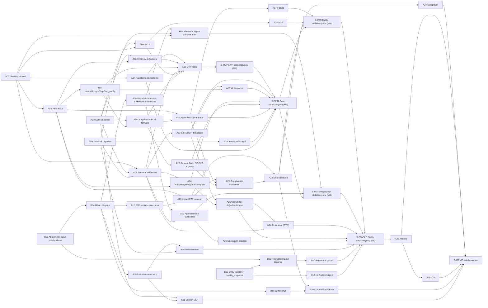

# WECOMMANDER V2 — Bağımlılık Matrisi

- **Tarih:** 2026-11-07
- **Kaynak:** [`WECOMMANDER_V2_MASTER_PLAN.md`](./WECOMMANDER_V2_MASTER_PLAN.md)
- **Takvim:** [`WECOMMANDER_V2_DEVELOPMENT_CALENDAR.md`](./WECOMMANDER_V2_DEVELOPMENT_CALENDAR.md). Takvim bu matristeki bağımlılıklarla hesaplanmıştır.

## 1. Kurallar

1. **Ön koşul**, bağımlı paketin başlaması için tamamlanmış (merge edilmiş, CI yeşil) olmalıdır.
2. `S-*` paketleri stabilizasyon dönemleridir ve yeni özellik içermez.
3. Bir paketin ön koşulu değişirse önce bu belge, sonra takvim güncellenir.
4. **Agent Mode güvenlik sırası değiştirilemez:** B01, User Mode'daki AI ile ilgili hiçbir paketten (A24) ve web/masaüstü terminalinden (B05, B06, B09) sonra gelemez.

## 2. Bağımlılık matrisi

"Aynı anda çalışan" sütunu S2 takvimindeki çakışmaları gösterir; bunlar paralel yürütülebilir.

| Paket | Ad | Doğrudan ön koşullar | Doğrudan bağımlılar | Tüm ön koşul sayısı | S2'de aynı anda çalışan |
|---|---|---|---|---|---|
| B01 | AI terminal_input yetkilendirme | — | B02, B04 | 0 | A02 |
| B02 | Production kabul kapanışı | B01, B03 | B07 | 2 | A02 |
| B03 | Onay tüketimi + health_snapshot | — | B02, B12 | 0 | A02 |
| B04 | MFA + step-up | B01 | B05, B08, B10, B13 | 1 | A01, A03 |
| B05 | İnsan terminali akışı | B04 | B06, B11 | 2 | A12, B12 |
| B06 | Web terminali | B05, A03 | S-STABLE | 4 | A12, A13 |
| B07 | Regresyon paketi | B02 | S-STABLE | 3 | A11 |
| B08 | Masaüstü oturum + SSH eşleştirme uçları | B04 | B09, A23 | 2 | A17 |
| B09 | Masaüstü Agent çalışma alanı | B08, A03, A01 | S-INT | 5 | A23 |
| B10 | E2E senkron sunucusu | B04 | A20 | 2 | A18, A26 |
| B11 | Bastion SSH | A02, B05 | S-M7 | 4 | A28, A29 |
| B12 | v1.2 gözlem işleri | B03 | S-STABLE | 1 | B05, S-MVP |
| B13 | OIDC SSO | B04 | A30 | 2 | A27, A28 |
| A01 | Desktop iskeleti | — | A04, A05, A08, A09, B09 | 0 | B04 |
| A02 | SSH çekirdeği | — | A06, A08, A09, A10, B11 | 0 | B01, B02, B03 |
| A03 | Terminal UI paketi | — | B06, A08, A19, B09 | 0 | A05, B04 |
| A04 | Paketleme/güncelleme | A01 | A11, S-BETA | 1 | A06, A07 |
| A05 | Yerel kasa | A01 | A06, A07, A14, A16, A20 | 1 | A03, A08 |
| A06 | Host key doğrulama | A02, A05 | A11 | 3 | A04, A09 |
| A07 | Hosts/Groups/Tags/ssh_config | A05 | A10, A11, A13 | 2 | A04, A08 |
| A08 | Terminal sekmeleri | A01, A02, A03 | A11, A12, A14, A23, A24 | 3 | A05, A07 |
| A09 | SFTP | A02, A01 | A11, A18 | 2 | A06, A10 |
| A10 | Jump host + local forward | A02, A07 | A11, A15, A16 | 4 | A09 |
| A11 | MVP kabul | A04, A06, A07, A08, A09, A10 | S-MVP | 10 | B07 |
| A12 | Split view + broadcast | A08 | A13, S-BETA, A25 | 4 | B05, B06 |
| A13 | Workspaces | A12, A07 | S-BETA | 7 | A15, B06 |
| A14 | Snippets/geçmiş/autocomplete | A08, A05 | S-BETA, A25 | 5 | A15, A16 |
| A15 | Remote fwd + SOCKS + proxy | A10 | S-BETA, A21 | 5 | A13, A14 |
| A16 | Agent fwd + sertifikalar | A05, A10 | S-BETA, A17, A21 | 5 | A14, A19 |
| A17 | FIDO2 | A16 | S-PAR | 6 | B08, S-BETA |
| A18 | SCP | A09 | S-PAR | 3 | B10, S-INT |
| A19 | Tema/font/kısayol | A03 | S-BETA | 1 | A16 |
| A20 | Kişisel E2E senkron | A05, B10 | A21, A22 | 5 | A24, A25, A26 |
| A21 | Dış güvenlik incelemesi | A20, A16, A15 | A22 | 11 | A24 |
| A22 | Ekip özellikleri | A20, A21 | S-PAR, A27, A30 | 12 | A24 |
| A23 | Agent Mode'a yükseltme | B08, A08 | S-INT, A26 | 7 | B09 |
| A24 | AI asistanı (BYO) | A25, A08 | S-STABLE | 8 | A20, A21, A22 |
| A25 | Komut risk değerlendirmesi | A12, A14 | A24, S-STABLE | 7 | A20 |
| A26 | Operasyon araçları | A23 | S-STABLE | 8 | A20, B10 |
| A27 | Multiplayer | A22 | S-M7 | 13 | B13, S-PAR, S-STABLE |
| A28 | Android | S-STABLE | A29, S-M7 | 42 | A30, B11, B13 |
| A29 | iOS | A28 | S-M7 | 43 | B11 |
| A30 | Kurumsal politikalar | A22, B13 | S-M7 | 14 | A28 |
| S-BETA | Beta stabilizasyonu (M3) | S-MVP, A12, A13, A14, A15, A16, A19, A04 | S-INT, S-PAR | 18 | A17 |
| S-INT | Entegrasyon stabilizasyonu (M4) | B09, A23, S-BETA | S-STABLE | 24 | A18 |
| S-M7 | M7 stabilizasyonu | A27, A28, A29, A30, B11 | — | 48 | — |
| S-MVP | MVP stabilizasyonu (M2) | A11 | S-BETA | 11 | B12 |
| S-PAR | Eşitlik stabilizasyonu (M5) | A17, A18, A22, S-BETA | S-STABLE | 27 | A27 |
| S-STABLE | Stable stabilizasyonu (M6) | S-PAR, S-INT, A24, A25, A26, B06, B07, B12 | A28 | 41 | A27 |

## 3. Bağımlılık grafiği

## 4. İki mod arasındaki bağımlılık sınırları

| Yön | Bağımlılık | Bağımsızlık güvencesi |
|---|---|---|
| User Mode → Agent Mode | Yalnız A20/A22 (senkronizasyon sunucusu B10) ve A23 (eşleştirme uçları B08) | User Mode senkronizasyonsuz ve hesapsız tam çalışır; B08/B10 yoksa ilgili özellik görünmez |
| Agent Mode → User Mode | B06 ve B09, A03 terminal paketini kullanır; B11, A02 SSH çekirdeğini kullanır | Paylaşım sürümlü paket/crate üzerinden; çalışma anında karşılıklı çağrı yok |
| Ortak | `wc-redact` (A24'te `redact.rs`'den ayrılır) | Ajanın maskeleme davranışı değişmez; mevcut testler korunur |
| Değişmeyenler | `devices` tablosu, cihaz token'ları, MCP araç sözleşmeleri, onay HMAC şeması (B01 hariç genişletme) | Geriye dönük uyumluluk her B paketinin kabul kriteri |

## 5. Hemen başlanabilecek paketler (ön koşulu olmayan)

B01, B03, A01, A02, A03. Bu beşi birbirinden bağımsızdır ve 9 Kasım 2026 haftasında başlatılabilir. S1'de sıra: B01 → B03 → B02 → B04 → A01 …; S2'de D1 B01'i, D2 A02'yi alır.
