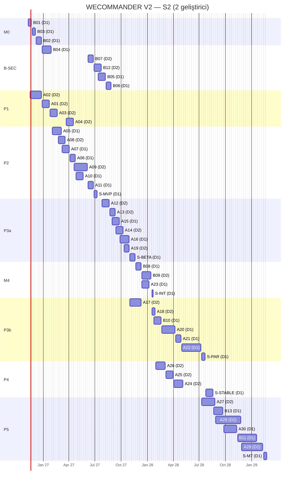
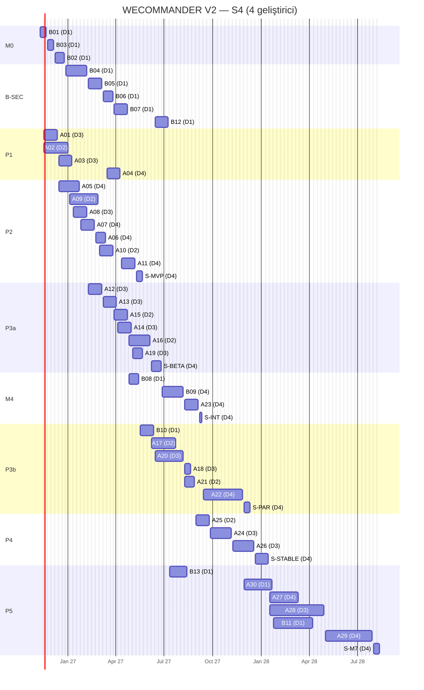
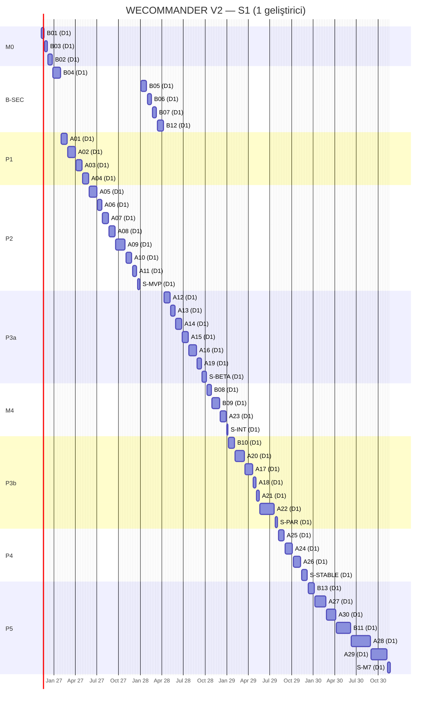

# WECOMMANDER V2 — Geliştirme Takvimi ve Kaynak Senaryoları

- **Tarih:** 2026-11-07 · **Planlama başlangıcı:** 2026-11-09 (Pazartesi, W1)
- **Kaynak:** [`WECOMMANDER_V2_MASTER_PLAN.md`](./WECOMMANDER_V2_MASTER_PLAN.md) (43 iş paketi, efor orta noktaları)
- **Önerilen temel senaryo:** **S2 (iki tam zamanlı geliştirici).** S1 teknik olarak mümkün ama V2 Stable'ı 2029 sonuna taşır.

## 1. Hesaplama yöntemi

Takvim, efor toplamının geliştirici sayısına bölünmesiyle **hesaplanmadı.** Kullanılan model:

1. Her iş paketinin süresi = ⌈efor (MH) ÷ 0,8 etkin kapasite × koordinasyon katsayısı⌉ hafta. Katsayı S1'de 1,0, S2'de 1,10, S4'te 1,25.
2. Her paket bir **kulvara** (geliştiriciye) atanır; bir kulvar aynı anda tek paket yürütür.
3. Bir paket ancak **tüm ön koşulları bittiğinde** ve kulvarı boş olduğunda başlar (Dependency Matrix'teki bağımlılıklar).
4. **Stabilizasyon dönemleri** ayrı paketlerdir ve yeni özellik içermez: MVP 2 hafta, Beta 3 hafta, Agent entegrasyonu 1 hafta, Termius eşitliği 2 hafta, Stable 4 hafta, M7 2 hafta. Gerçek cihaz kabulü (Windows, macOS, Linux) bu dönemlerde yapılır.
5. **Tampon:** Her kilometre taşının hedef sürüm tarihi = plan tarihi + başlangıçtan o tarihe kadar geçen sürenin yaklaşık %15'i (birikimli).
6. Yeni geliştiriciler 1 hafta işe alışma gecikmesiyle başlar.
7. AI destekli verimlilik kazancı **varsayılmadı** (Master Plan §7).
8. Haftalar Pazartesi başlar; bitiş tarihleri Cuma'dır. Resmî tatiller ve izinler 0,8 etkin kapasite katsayısının içindedir; ayrı hafta olarak düşülmedi. Uzun bayram dönemlerinde (Ramazan Bayramı Mart 2027, Kurban Bayramı Mayıs 2027) ilgili haftalarda gecikme tamponu kullanılır.

**Eksik kaynak bilgileri (varsayım):** Geliştiricilerin deneyim düzeyi eşit; S2 ve S4'teki ek geliştiriciler Rust ve TypeScript bilen kişiler; sahip her kilometre taşında production onayı ve gerçek cihaz kabulü için zaman ayırır; Apple Developer hesabı kararı M3'ten önce verilir.

## 2. Senaryo özeti

| Kilometre taşı | S1 plan | S1 hedef | S2 plan | S2 hedef | S4 plan | S4 hedef |
|---|---|---|---|---|---|---|
| **M0** Agent Mode güvenlik ve production kapanışı | 2026-12-25 | 2027-01-08 | **2026-12-25** | **2027-01-08** | 2026-12-25 | 2027-01-08 |
| **M1** Çalışan User Mode SSH prototipi | 2027-04-30 | 2027-05-28 | **2027-02-19** | **2027-03-12** | 2027-01-08 | 2027-01-22 |
| **M2** User Mode kullanılabilir MVP | 2027-12-31 | 2028-03-03 | **2027-07-09** | **2027-08-20** | 2027-05-21 | 2027-06-25 |
| **M3** Windows/Linux/macOS Beta | 2028-10-06 | 2029-01-19 | **2027-11-19** | **2028-01-21** | 2027-06-25 | 2027-07-30 |
| **M4** Agent Mode entegrasyonu | 2029-01-05 | 2029-05-04 | **2028-01-21** | **2028-03-31** | 2027-09-10 | 2027-10-29 |
| **M5** Termius özellik eşitliği | 2029-08-03 | 2030-01-04 | **2028-07-21** | **2028-10-27** | 2027-12-10 | 2028-02-11 |
| **M6** WECOMMANDER V2 Stable | 2029-12-07 | 2030-05-31 | **2028-08-18** | **2028-11-24** | 2028-01-14 | 2028-03-24 |
| **M7** Mobil ve kurumsal genişleme | 2030-11-22 | 2031-07-04 | **2029-02-23** | **2029-06-29** | 2028-08-11 | 2028-11-17 |

**Kulvarlar**
- **S1:** D1 tek geliştirici; tüm işler sıralı. Agent Mode güvenlik işleri (B01–B04) User Mode'dan önce yapılır.
- **S2:** D1 = Agent Mode + Rust çekirdek/kasa/tüneller; D2 = SSH çekirdeği başlangıcı, masaüstü, arayüz, SFTP, entegrasyon.
- **S4:** D1 = Agent Mode/gateway; D2 = Rust SSH çekirdeği ve ağ işlevleri; D3 = masaüstü ve arayüz; D4 = kasa, dosya, entegrasyon, ekip ve stabilizasyon sorumlusu.

## 3. Aşama tabloları (başlangıç, bitiş, süre, kapasite, hedef)

Aşamalar paralel yürüdüğü için tarihleri örtüşebilir. "Kapasite", aşamadaki paketlerin koordinasyon öncesi efor toplamıdır.

#### S1 — aşama tablosu

| Aşama | Başlangıç | Plan bitişi | Süre (hafta) | Kapasite (MH) | Hedef (≈%15 tampon) |
|---|---|---|---|---|---|
| Agent Mode güvenlik ve production kapanışı | 2026-11-09 | 2026-12-25 | 7 | 4.25 | 2027-01-08 |
| Agent Mode güvenlik ve web terminali | 2026-12-28 | 2028-04-07 | 67 | 12.25 | 2028-06-30 |
| Aşama 1 — Masaüstü temel altyapısı (M1 prototip: A01–A03) | 2027-02-01 | 2027-05-28 | 17 | 11.50 | 2027-07-02 |
| Aşama 2 — SSH MVP (M2) | 2027-05-31 | 2027-12-31 | 31 | 19.25 | 2028-03-03 |
| Aşama 3a — Beta özellikleri (M3) | 2028-04-10 | 2028-10-06 | 26 | 14.75 | 2029-01-19 |
| Agent Mode entegrasyonu (M4) | 2028-10-09 | 2029-01-05 | 13 | 7.75 | 2029-05-04 |
| Aşama 3b — Termius eşitliği: FIDO2, SCP, senkron, ekip (M5) | 2029-01-08 | 2029-08-03 | 30 | 20.50 | 2030-01-04 |
| Aşama 4 — Farklılaştırıcılar ve V2 Stable (M6) | 2029-08-06 | 2029-12-07 | 18 | 9.50 | 2030-05-31 |
| Aşama 5 — Mobil ve kurumsal (M7) | 2029-12-10 | 2030-11-22 | 50 | 36.50 | 2031-07-04 |

| Kilometre taşı | Plan tarihi | Hedef sürüm tarihi (tampon dahil) |
|---|---|---|
| M0 | 2026-12-25 | 2027-01-08 |
| M1 | 2027-04-30 | 2027-05-28 |
| M2 | 2027-12-31 | 2028-03-03 |
| M3 | 2028-10-06 | 2029-01-19 |
| M4 | 2029-01-05 | 2029-05-04 |
| M5 | 2029-08-03 | 2030-01-04 |
| M6 | 2029-12-07 | 2030-05-31 |
| M7 | 2030-11-22 | 2031-07-04 |

#### S2 — aşama tablosu

| Aşama | Başlangıç | Plan bitişi | Süre (hafta) | Kapasite (MH) | Hedef (≈%15 tampon) |
|---|---|---|---|---|---|
| Agent Mode güvenlik ve production kapanışı | 2026-11-09 | 2026-12-25 | 7 | 4.25 | 2027-01-08 |
| Agent Mode güvenlik ve web terminali | 2026-12-28 | 2027-08-27 | 35 | 12.25 | 2027-10-15 |
| Aşama 1 — Masaüstü temel altyapısı (M1 prototip: A01–A03) | 2026-11-16 | 2027-04-16 | 22 | 11.50 | 2027-05-14 |
| Aşama 2 — SSH MVP (M2) | 2027-02-01 | 2027-07-09 | 23 | 19.25 | 2027-08-20 |
| Aşama 3a — Beta özellikleri (M3) | 2027-07-26 | 2027-11-19 | 17 | 14.75 | 2028-01-21 |
| Agent Mode entegrasyonu (M4) | 2027-11-22 | 2028-01-21 | 9 | 7.75 | 2028-03-31 |
| Aşama 3b — Termius eşitliği: FIDO2, SCP, senkron, ekip (M5) | 2027-11-01 | 2028-07-21 | 38 | 20.50 | 2028-10-27 |
| Aşama 4 — Farklılaştırıcılar ve V2 Stable (M6) | 2028-01-31 | 2028-08-18 | 29 | 9.50 | 2028-11-24 |
| Aşama 5 — Mobil ve kurumsal (M7) | 2028-07-10 | 2029-02-23 | 33 | 36.50 | 2029-06-29 |

| Kilometre taşı | Plan tarihi | Hedef sürüm tarihi (tampon dahil) |
|---|---|---|
| M0 | 2026-12-25 | 2027-01-08 |
| M1 | 2027-02-19 | 2027-03-12 |
| M2 | 2027-07-09 | 2027-08-20 |
| M3 | 2027-11-19 | 2028-01-21 |
| M4 | 2028-01-21 | 2028-03-31 |
| M5 | 2028-07-21 | 2028-10-27 |
| M6 | 2028-08-18 | 2028-11-24 |
| M7 | 2029-02-23 | 2029-06-29 |

#### S4 — aşama tablosu

| Aşama | Başlangıç | Plan bitişi | Süre (hafta) | Kapasite (MH) | Hedef (≈%15 tampon) |
|---|---|---|---|---|---|
| Agent Mode güvenlik ve production kapanışı | 2026-11-09 | 2026-12-25 | 7 | 4.25 | 2027-01-08 |
| Agent Mode güvenlik ve web terminali | 2026-12-28 | 2027-07-09 | 28 | 12.25 | 2027-08-20 |
| Aşama 1 — Masaüstü temel altyapısı (M1 prototip: A01–A03) | 2026-11-16 | 2027-04-09 | 21 | 11.50 | 2027-05-07 |
| Aşama 2 — SSH MVP (M2) | 2026-12-14 | 2027-05-21 | 23 | 19.25 | 2027-06-25 |
| Aşama 3a — Beta özellikleri (M3) | 2027-02-08 | 2027-06-25 | 20 | 14.75 | 2027-07-30 |
| Agent Mode entegrasyonu (M4) | 2027-04-26 | 2027-09-10 | 20 | 7.75 | 2027-10-29 |
| Aşama 3b — Termius eşitliği: FIDO2, SCP, senkron, ekip (M5) | 2027-05-17 | 2027-12-10 | 30 | 20.50 | 2028-02-11 |
| Aşama 4 — Farklılaştırıcılar ve V2 Stable (M6) | 2027-08-30 | 2028-01-14 | 20 | 9.50 | 2028-03-24 |
| Aşama 5 — Mobil ve kurumsal (M7) | 2027-07-12 | 2028-08-11 | 57 | 36.50 | 2028-11-17 |

| Kilometre taşı | Plan tarihi | Hedef sürüm tarihi (tampon dahil) |
|---|---|---|
| M0 | 2026-12-25 | 2027-01-08 |
| M1 | 2027-01-08 | 2027-01-22 |
| M2 | 2027-05-21 | 2027-06-25 |
| M3 | 2027-06-25 | 2027-07-30 |
| M4 | 2027-09-10 | 2027-10-29 |
| M5 | 2027-12-10 | 2028-02-11 |
| M6 | 2028-01-14 | 2028-03-24 |
| M7 | 2028-08-11 | 2028-11-17 |

## 4. Kritik yol

| Senaryo | Kritik yol (V2 Stable'a kadar) |
|---|---|
| S1 | Tüm paketler tek kulvarda sıralı; kritik yol tüm işlerin toplamıdır. |
| S2 | A02 → A01 → A03 → A08 → A04 → A09 → A11 → MVP stabilizasyonu → B05 → B06 → A15 → A16 → Beta stabilizasyonu → B08 → B09 → Entegrasyon → B10 → A20 → A21 → A22 → Eşitlik stabilizasyonu → Stable stabilizasyonu |
| S4 | B01 → B03 → B02 → B04 → B05 → B06 → B07 → B08 → B10 → A20 → A21 → A25 → A24 → A26 → Stable stabilizasyonu |

**Yorum**
- S2'de darboğaz **SFTP (A09)** ve **senkronizasyon zinciri (B10 → A20 → A21 → A22)**.
- S4'te darboğaz **Agent Mode kulvarı (D1)**: senkronizasyon sunucusu (B10), Agent Mode'un güvenlik ve terminal işlerinin arkasında bekliyor. S4'te B10'un ayrı bir geliştiriciye verilmesi M5'i yaklaşık 6–8 hafta öne çekebilir. Bu iyileştirme, güvenlik işlerinin sırasını korumak için takvime yansıtılmadı.

## 5. Gantt diyagramları

Tarihler §3 ve Ek A tablolarıyla aynı kaynaktan üretilmiştir.

### 5.1 S2 (temel senaryo)

### 5.2 S4

### 5.3 S1

## 6. Haftalık geliştirme takvimi (S2)

"—" boş kulvar demektir: geliştirici ya ön koşul bekler ya da kod incelemesi, destek, regresyon ve hata düzeltmesine ayrılır. `S-` ile başlayan satırlar stabilizasyon dönemleridir.

| Hafta | Tarih (Pzt) | D1 (Agent/çekirdek) | D2 (Masaüstü/UI) |
|---|---|---|---|
| W1 | 2026-11-09 | B01 | — |
| W2 | 2026-11-16 | B01 | A02 |
| W3 | 2026-11-23 | B03 | A02 |
| W4 | 2026-11-30 | B03 | A02 |
| W5 | 2026-12-07 | B02 | A02 |
| W6 | 2026-12-14 | B02 | A02 |
| W7 | 2026-12-21 | B02 | A02 |
| W8 | 2026-12-28 | B04 | A01 |
| W9 | 2027-01-04 | B04 | A01 |
| W10 | 2027-01-11 | B04 | A01 |
| W11 | 2027-01-18 | B04 | A01 |
| W12 | 2027-01-25 | B04 | A03 |
| W13 | 2027-02-01 | A05 | A03 |
| W14 | 2027-02-08 | A05 | A03 |
| W15 | 2027-02-15 | A05 | A03 |
| W16 | 2027-02-22 | A05 | A08 |
| W17 | 2027-03-01 | A05 | A08 |
| W18 | 2027-03-08 | A07 | A08 |
| W19 | 2027-03-15 | A07 | A08 |
| W20 | 2027-03-22 | A07 | A04 |
| W21 | 2027-03-29 | A07 | A04 |
| W22 | 2027-04-05 | A06 | A04 |
| W23 | 2027-04-12 | A06 | A04 |
| W24 | 2027-04-19 | A06 | A09 |
| W25 | 2027-04-26 | A10 | A09 |
| W26 | 2027-05-03 | A10 | A09 |
| W27 | 2027-05-10 | A10 | A09 |
| W28 | 2027-05-17 | A10 | A09 |
| W29 | 2027-05-24 | — | A09 |
| W30 | 2027-05-31 | — | A09 |
| W31 | 2027-06-07 | A11 | B07 |
| W32 | 2027-06-14 | A11 | B07 |
| W33 | 2027-06-21 | A11 | B07 |
| W34 | 2027-06-28 | S-MVP | B12 |
| W35 | 2027-07-05 | S-MVP | B12 |
| W36 | 2027-07-12 | B05 | B12 |
| W37 | 2027-07-19 | B05 | B12 |
| W38 | 2027-07-26 | B05 | A12 |
| W39 | 2027-08-02 | B05 | A12 |
| W40 | 2027-08-09 | B06 | A12 |
| W41 | 2027-08-16 | B06 | A12 |
| W42 | 2027-08-23 | B06 | A13 |
| W43 | 2027-08-30 | A15 | A13 |
| W44 | 2027-09-06 | A15 | A13 |
| W45 | 2027-09-13 | A15 | A14 |
| W46 | 2027-09-20 | A15 | A14 |
| W47 | 2027-09-27 | A16 | A14 |
| W48 | 2027-10-04 | A16 | A14 |
| W49 | 2027-10-11 | A16 | A19 |
| W50 | 2027-10-18 | A16 | A19 |
| W51 | 2027-10-25 | A16 | A19 |
| W52 | 2027-11-01 | S-BETA | A17 |
| W53 | 2027-11-08 | S-BETA | A17 |
| W54 | 2027-11-15 | S-BETA | A17 |
| W55 | 2027-11-22 | B08 | A17 |
| W56 | 2027-11-29 | B08 | A17 |
| W57 | 2027-12-06 | B08 | A17 |
| W58 | 2027-12-13 | A23 | B09 |
| W59 | 2027-12-20 | A23 | B09 |
| W60 | 2027-12-27 | A23 | B09 |
| W61 | 2028-01-03 | A23 | B09 |
| W62 | 2028-01-10 | — | B09 |
| W63 | 2028-01-17 | S-INT | A18 |
| W64 | 2028-01-24 | B10 | A18 |
| W65 | 2028-01-31 | B10 | A26 |
| W66 | 2028-02-07 | B10 | A26 |
| W67 | 2028-02-14 | B10 | A26 |
| W68 | 2028-02-21 | A20 | A26 |
| W69 | 2028-02-28 | A20 | A26 |
| W70 | 2028-03-06 | A20 | A25 |
| W71 | 2028-03-13 | A20 | A25 |
| W72 | 2028-03-20 | A20 | A25 |
| W73 | 2028-03-27 | A20 | A25 |
| W74 | 2028-04-03 | A20 | A24 |
| W75 | 2028-04-10 | A21 | A24 |
| W76 | 2028-04-17 | A21 | A24 |
| W77 | 2028-04-24 | A21 | A24 |
| W78 | 2028-05-01 | A22 | A24 |
| W79 | 2028-05-08 | A22 | — |
| W80 | 2028-05-15 | A22 | — |
| W81 | 2028-05-22 | A22 | — |
| W82 | 2028-05-29 | A22 | — |
| W83 | 2028-06-05 | A22 | — |
| W84 | 2028-06-12 | A22 | — |
| W85 | 2028-06-19 | A22 | — |
| W86 | 2028-06-26 | A22 | — |
| W87 | 2028-07-03 | A22 | — |
| W88 | 2028-07-10 | S-PAR | A27 |
| W89 | 2028-07-17 | S-PAR | A27 |
| W90 | 2028-07-24 | S-STABLE | A27 |
| W91 | 2028-07-31 | S-STABLE | A27 |
| W92 | 2028-08-07 | S-STABLE | A27 |
| W93 | 2028-08-14 | S-STABLE | A27 |
| W94 | 2028-08-21 | B13 | A27 |
| W95 | 2028-08-28 | B13 | A28 |
| W96 | 2028-09-04 | B13 | A28 |
| W97 | 2028-09-11 | B13 | A28 |
| W98 | 2028-09-18 | B13 | A28 |
| W99 | 2028-09-25 | A30 | A28 |
| W100 | 2028-10-02 | A30 | A28 |
| W101 | 2028-10-09 | A30 | A28 |
| W102 | 2028-10-16 | A30 | A28 |
| W103 | 2028-10-23 | A30 | A28 |
| W104 | 2028-10-30 | A30 | A28 |
| W105 | 2028-11-06 | A30 | A28 |
| W106 | 2028-11-13 | B11 | A28 |
| W107 | 2028-11-20 | B11 | A28 |
| W108 | 2028-11-27 | B11 | A29 |
| W109 | 2028-12-04 | B11 | A29 |
| W110 | 2028-12-11 | B11 | A29 |
| W111 | 2028-12-18 | B11 | A29 |
| W112 | 2028-12-25 | B11 | A29 |
| W113 | 2029-01-01 | B11 | A29 |
| W114 | 2029-01-08 | B11 | A29 |
| W115 | 2029-01-15 | B11 | A29 |
| W116 | 2029-01-22 | — | A29 |
| W117 | 2029-01-29 | — | A29 |
| W118 | 2029-02-05 | — | A29 |
| W119 | 2029-02-12 | S-M7 | — |
| W120 | 2029-02-19 | S-M7 | — |

## 7. Aylık yol haritası (S2)

| Ay | Aktif iş paketleri (S2) |
|---|---|
| 2026-11 | A02, B01, B03 |
| 2026-12 | A01, A02, B02, B04 |
| 2027-01 | A01, A03, B04 |
| 2027-02 | A03, A05, A08 |
| 2027-03 | A04, A05, A07, A08 |
| 2027-04 | A04, A06, A09, A10 |
| 2027-05 | A09, A10 |
| 2027-06 | A11, B07, B12, S-MVP |
| 2027-07 | A12, B05, B12, S-MVP |
| 2027-08 | A12, A13, A15, B05, B06 |
| 2027-09 | A13, A14, A15, A16 |
| 2027-10 | A14, A16, A19 |
| 2027-11 | A17, B08, S-BETA |
| 2027-12 | A17, A23, B08, B09 |
| 2028-01 | A18, A23, A26, B09, B10, S-INT |
| 2028-02 | A20, A26, B10 |
| 2028-03 | A20, A25 |
| 2028-04 | A20, A21, A24 |
| 2028-05 | A22, A24 |
| 2028-06 | A22 |
| 2028-07 | A22, A27, S-PAR, S-STABLE |
| 2028-08 | A27, A28, B13, S-STABLE |
| 2028-09 | A28, A30, B13 |
| 2028-10 | A28, A30 |
| 2028-11 | A28, A29, A30, B11 |
| 2028-12 | A29, B11 |
| 2029-01 | A29, B11 |
| 2029-02 | A29, S-M7 |

## 8. Paralel geliştirme matrisi

| Dönem (S2) | D1 | D2 | Paralel yürütülebilmesinin nedeni |
|---|---|---|---|
| Kasım 2026 – Şubat 2027 | B01, B03, B02, B04 (Agent güvenliği) | A02, A01, A03 (masaüstü temeli) | Ortak dosya yok; User Mode yeni dizinlerde |
| Şubat – Haziran 2027 | A05, A07, A06, A10, A11 | A08, A04, A09, B07 | Kasa ve host modeli ile terminal ve SFTP ayrı crate ve modüllerde |
| Temmuz – Ekim 2027 | MVP stabilizasyonu, B05, B06, A15, A16 | B12, A12, A13, A14, A19 | Agent terminal akışı ile User Mode arayüz özellikleri bağımsız |
| Kasım 2027 – Temmuz 2028 | Beta stabilizasyonu, B08, A23, entegrasyon, B10, A20, A21, A22, eşitlik ve Stable stabilizasyonu | A17, B09, A18, A26, A25, A24, A27 | Entegrasyon ve senkronizasyon ile FIDO2, Agent sekmesi ve AI özellikleri ayrı |
| Ağustos 2028 sonrası | B13, A30, B11 | A27, A28, A29 | Mobil, kurumsal ve bastion bağımsız |

**Aynı anda yürütülmemesi gerekenler:** A20 ile A22 (aynı kripto modeli; inceleme A21 araya girer); B04 ile B05 (aynı kimlik doğrulama yüzeyi); A05 ile A20'nin kasa biçimi değişiklikleri (A05 biçimi dondurulmadan A20 başlamaz).

## 9. Sürüm takvimi (S2)

| Sürüm | İçerik | Plan | Hedef (tampon dahil) | Kanal |
|---|---|---|---|---|
| Agent Mode **v1.0** | B01–B03; production kabul kapanışı | 2026-12-25 | 2027-01-08 | production (promote-production) |
| Desktop **0.1 prototip** | A01–A03 (dahili) | 2027-02-19 | 2027-03-12 | dahili |
| Desktop **0.5 MVP** | A04–A11 | 2027-07-09 | 2027-08-20 | erken erişim (davetli) |
| Agent Mode **v1.1** | B04 MFA (+B05 akışı) | 2027-01-29 (B04) | — | production |
| Agent Mode **v1.2** | B06 web terminali, B07, B12 | 2027-08-27 | — | production |
| Desktop **0.8 Beta** | A12–A16, A19 | 2027-11-19 | 2028-01-21 | genel beta (3 işletim sistemi) |
| Desktop **0.9** | B08, B09, A23 (Agent'a yükseltme) | 2028-01-21 | 2028-03-31 | beta |
| Desktop **0.95 RC** | A17, A18, A20–A22, B10 (eşitlik) | 2028-07-21 | 2028-10-27 | sürüm adayı |
| **WECOMMANDER V2.0 Stable** | A24–A26 + tüm M0–M5 | 2028-08-18 | 2028-11-24 | stable |
| V2.1 | A27–A30, B11, B13; mobil | 2029-02-23 | 2029-06-29 | stable + mobil test kanalları |

## 10. Risk ve gecikme senaryoları (S2 üzerinden)

| Senaryo | Olasılık | Etki | Gecikme tahmini | Azaltma |
|---|---|---|---|---|
| `russh-sftp` yetersiz; SFTP katmanı yeniden yazılır | Orta | A09 kritik yolda | MVP +2–3 hafta | A02 sırasında erken teknik doğrulama (spike) |
| Linux WebKitGTK'de xterm.js yavaş | Orta | Linux Beta | M3 +2 hafta (yalnız Linux) | Çizici düşürme; Linux'ta Beta'yı ayrı ilan etme |
| A21 dış incelemede kritik bulgu | Orta | Ekip kasası tasarımı | M5 +4–8 hafta | Tasarım belgesinin A20 başlamadan ön incelemesi |
| Apple hesabı kararı gecikir | Orta | macOS dağıtımı | macOS Beta gecikir; Windows/Linux etkilenmez | Karar M2'den önce |
| Bir geliştirici 1 ay ayrılır | Orta | Kulvar durur | İlgili kulvarda +5 hafta | Paketlerin bağımsız PR'larla bitirilmesi; bilgi paylaşımı |
| Agent Mode'da production olayı | Düşük–orta | D1 kesintisi | +1–2 hafta | B07 regresyonu; olay çalışma kitabı |
| Termius'un yeni bir özellik çıkarması | Yüksek | Kapsam baskısı | Planlanmaz | Değişiklik yalnız kilometre taşı sınırında kabul edilir |
| AI destekli geliştirme beklenenden verimli | Orta | Pozitif | −10–25% | Kazanç tampon olarak tutulur; tarih öne çekilmez |

## 11. Toplam geliştirme kapasitesi ihtiyacı

| Senaryo | Efor × koordinasyon | Takvim (hafta) | Mevcut kapasite | Kullanım | V2 Stable (plan / hedef) |
|---|---|---|---|---|---|
| S1 | 136,3 MH | 211 | 168,8 MH | %81 | 2029-12-07 / 2030-05-31 |
| S2 | 149,9 MH | 120 | 192,0 MH | %78 | 2028-08-18 / 2028-11-24 |
| S4 | 170,3 MH | 92 | 294,4 MH | %58 | 2028-01-14 / 2028-03-24 |

S4'teki düşük kullanım beklenen bir sonuç: bağımlılık zinciri dört kulvarı her zaman dolduramıyor. Boş haftalar regresyon, dokümantasyon ve hata düzeltmesine ayrılmalı. Dört kişiden fazlası takvimi kayda değer biçimde kısaltmaz.

## Ek A — Paket bazında takvim (üç senaryo)

#### S1 — iş paketi takvimi

Toplam efor 136.25 MH × koordinasyon 1.0 = 136.2 MH; 1 geliştirici × 211 hafta × 0,8 = 168.8 MH kapasite → kullanım ≈ %81.

| Paket | Kulvar | Başlangıç | Bitiş | Hafta |
|---|---|---|---|---|
| B01 | D1 | 2026-11-09 | 2026-11-20 | 2 |
| B03 | D1 | 2026-11-23 | 2026-12-04 | 2 |
| B02 | D1 | 2026-12-07 | 2026-12-25 | 3 |
| B04 | D1 | 2026-12-28 | 2027-01-29 | 5 |
| A01 | D1 | 2027-02-01 | 2027-02-26 | 4 |
| A02 | D1 | 2027-03-01 | 2027-04-02 | 5 |
| A03 | D1 | 2027-04-05 | 2027-04-30 | 4 |
| A04 | D1 | 2027-05-03 | 2027-05-28 | 4 |
| A05 | D1 | 2027-05-31 | 2027-07-02 | 5 |
| A06 | D1 | 2027-07-05 | 2027-07-23 | 3 |
| A07 | D1 | 2027-07-26 | 2027-08-20 | 4 |
| A08 | D1 | 2027-08-23 | 2027-09-17 | 4 |
| A09 | D1 | 2027-09-20 | 2027-10-29 | 6 |
| A10 | D1 | 2027-11-01 | 2027-11-26 | 4 |
| A11 | D1 | 2027-11-29 | 2027-12-17 | 3 |
| S-MVP | D1 | 2027-12-20 | 2027-12-31 | 2 |
| B05 | D1 | 2028-01-03 | 2028-01-28 | 4 |
| B06 | D1 | 2028-01-31 | 2028-02-18 | 3 |
| B07 | D1 | 2028-02-21 | 2028-03-10 | 3 |
| B12 | D1 | 2028-03-13 | 2028-04-07 | 4 |
| A12 | D1 | 2028-04-10 | 2028-05-05 | 4 |
| A13 | D1 | 2028-05-08 | 2028-05-26 | 3 |
| A14 | D1 | 2028-05-29 | 2028-06-23 | 4 |
| A15 | D1 | 2028-06-26 | 2028-07-21 | 4 |
| A16 | D1 | 2028-07-24 | 2028-08-25 | 5 |
| A19 | D1 | 2028-08-28 | 2028-09-15 | 3 |
| S-BETA | D1 | 2028-09-18 | 2028-10-06 | 3 |
| B08 | D1 | 2028-10-09 | 2028-10-27 | 3 |
| B09 | D1 | 2028-10-30 | 2028-12-01 | 5 |
| A23 | D1 | 2028-12-04 | 2028-12-29 | 4 |
| S-INT | D1 | 2029-01-01 | 2029-01-05 | 1 |
| B10 | D1 | 2029-01-08 | 2029-02-02 | 4 |
| A20 | D1 | 2029-02-05 | 2029-03-16 | 6 |
| A17 | D1 | 2029-03-19 | 2029-04-20 | 5 |
| A18 | D1 | 2029-04-23 | 2029-05-04 | 2 |
| A21 | D1 | 2029-05-07 | 2029-05-18 | 2 |
| A22 | D1 | 2029-05-21 | 2029-07-20 | 9 |
| S-PAR | D1 | 2029-07-23 | 2029-08-03 | 2 |
| A25 | D1 | 2029-08-06 | 2029-08-31 | 4 |
| A24 | D1 | 2029-09-03 | 2029-10-05 | 5 |
| A26 | D1 | 2029-10-08 | 2029-11-09 | 5 |
| S-STABLE | D1 | 2029-11-12 | 2029-12-07 | 4 |
| B13 | D1 | 2029-12-10 | 2030-01-04 | 4 |
| A27 | D1 | 2030-01-07 | 2030-02-22 | 7 |
| A30 | D1 | 2030-02-25 | 2030-04-05 | 6 |
| B11 | D1 | 2030-04-08 | 2030-06-07 | 9 |
| A28 | D1 | 2030-06-10 | 2030-08-30 | 12 |
| A29 | D1 | 2030-09-02 | 2030-11-08 | 10 |
| S-M7 | D1 | 2030-11-11 | 2030-11-22 | 2 |

#### S2 — iş paketi takvimi

Toplam efor 136.25 MH × koordinasyon 1.1 = 149.9 MH; 2 geliştirici × 120 hafta × 0,8 = 192.0 MH kapasite → kullanım ≈ %78.

| Paket | Kulvar | Başlangıç | Bitiş | Hafta |
|---|---|---|---|---|
| B01 | D1 | 2026-11-09 | 2026-11-20 | 2 |
| A02 | D2 | 2026-11-16 | 2026-12-25 | 6 |
| B03 | D1 | 2026-11-23 | 2026-12-04 | 2 |
| B02 | D1 | 2026-12-07 | 2026-12-25 | 3 |
| B04 | D1 | 2026-12-28 | 2027-01-29 | 5 |
| A01 | D2 | 2026-12-28 | 2027-01-22 | 4 |
| A03 | D2 | 2027-01-25 | 2027-02-19 | 4 |
| A05 | D1 | 2027-02-01 | 2027-03-05 | 5 |
| A08 | D2 | 2027-02-22 | 2027-03-19 | 4 |
| A07 | D1 | 2027-03-08 | 2027-04-02 | 4 |
| A04 | D2 | 2027-03-22 | 2027-04-16 | 4 |
| A06 | D1 | 2027-04-05 | 2027-04-23 | 3 |
| A09 | D2 | 2027-04-19 | 2027-06-04 | 7 |
| A10 | D1 | 2027-04-26 | 2027-05-21 | 4 |
| B07 | D2 | 2027-06-07 | 2027-06-25 | 3 |
| A11 | D1 | 2027-06-07 | 2027-06-25 | 3 |
| B12 | D2 | 2027-06-28 | 2027-07-23 | 4 |
| S-MVP | D1 | 2027-06-28 | 2027-07-09 | 2 |
| B05 | D1 | 2027-07-12 | 2027-08-06 | 4 |
| A12 | D2 | 2027-07-26 | 2027-08-20 | 4 |
| B06 | D1 | 2027-08-09 | 2027-08-27 | 3 |
| A13 | D2 | 2027-08-23 | 2027-09-10 | 3 |
| A15 | D1 | 2027-08-30 | 2027-09-24 | 4 |
| A14 | D2 | 2027-09-13 | 2027-10-08 | 4 |
| A16 | D1 | 2027-09-27 | 2027-10-29 | 5 |
| A19 | D2 | 2027-10-11 | 2027-10-29 | 3 |
| A17 | D2 | 2027-11-01 | 2027-12-10 | 6 |
| S-BETA | D1 | 2027-11-01 | 2027-11-19 | 3 |
| B08 | D1 | 2027-11-22 | 2027-12-10 | 3 |
| A23 | D1 | 2027-12-13 | 2028-01-07 | 4 |
| B09 | D2 | 2027-12-13 | 2028-01-14 | 5 |
| A18 | D2 | 2028-01-17 | 2028-01-28 | 2 |
| S-INT | D1 | 2028-01-17 | 2028-01-21 | 1 |
| B10 | D1 | 2028-01-24 | 2028-02-18 | 4 |
| A26 | D2 | 2028-01-31 | 2028-03-03 | 5 |
| A20 | D1 | 2028-02-21 | 2028-04-07 | 7 |
| A25 | D2 | 2028-03-06 | 2028-03-31 | 4 |
| A24 | D2 | 2028-04-03 | 2028-05-05 | 5 |
| A21 | D1 | 2028-04-10 | 2028-04-28 | 3 |
| A22 | D1 | 2028-05-01 | 2028-07-07 | 10 |
| S-PAR | D1 | 2028-07-10 | 2028-07-21 | 2 |
| A27 | D2 | 2028-07-10 | 2028-08-25 | 7 |
| S-STABLE | D1 | 2028-07-24 | 2028-08-18 | 4 |
| B13 | D1 | 2028-08-21 | 2028-09-22 | 5 |
| A28 | D2 | 2028-08-28 | 2028-11-24 | 13 |
| A30 | D1 | 2028-09-25 | 2028-11-10 | 7 |
| B11 | D1 | 2028-11-13 | 2029-01-19 | 10 |
| A29 | D2 | 2028-11-27 | 2029-02-09 | 11 |
| S-M7 | D1 | 2029-02-12 | 2029-02-23 | 2 |

#### S4 — iş paketi takvimi

Toplam efor 136.25 MH × koordinasyon 1.25 = 170.3 MH; 4 geliştirici × 92 hafta × 0,8 = 294.4 MH kapasite → kullanım ≈ %58.

| Paket | Kulvar | Başlangıç | Bitiş | Hafta |
|---|---|---|---|---|
| B01 | D1 | 2026-11-09 | 2026-11-20 | 2 |
| A02 | D2 | 2026-11-16 | 2027-01-01 | 7 |
| A01 | D3 | 2026-11-16 | 2026-12-11 | 4 |
| B03 | D1 | 2026-11-23 | 2026-12-04 | 2 |
| B02 | D1 | 2026-12-07 | 2026-12-25 | 3 |
| A03 | D3 | 2026-12-14 | 2027-01-08 | 4 |
| A05 | D4 | 2026-12-14 | 2027-01-22 | 6 |
| B04 | D1 | 2026-12-28 | 2027-02-05 | 6 |
| A09 | D2 | 2027-01-04 | 2027-02-26 | 8 |
| A08 | D3 | 2027-01-11 | 2027-02-05 | 4 |
| A07 | D4 | 2027-01-25 | 2027-02-19 | 4 |
| B05 | D1 | 2027-02-08 | 2027-03-05 | 4 |
| A12 | D3 | 2027-02-08 | 2027-03-05 | 4 |
| A06 | D4 | 2027-02-22 | 2027-03-12 | 3 |
| A10 | D2 | 2027-03-01 | 2027-03-26 | 4 |
| B06 | D1 | 2027-03-08 | 2027-03-26 | 3 |
| A13 | D3 | 2027-03-08 | 2027-04-02 | 4 |
| A04 | D4 | 2027-03-15 | 2027-04-09 | 4 |
| B07 | D1 | 2027-03-29 | 2027-04-23 | 4 |
| A15 | D2 | 2027-03-29 | 2027-04-23 | 4 |
| A14 | D3 | 2027-04-05 | 2027-04-30 | 4 |
| A11 | D4 | 2027-04-12 | 2027-05-07 | 4 |
| B08 | D1 | 2027-04-26 | 2027-05-14 | 3 |
| A16 | D2 | 2027-04-26 | 2027-06-04 | 6 |
| A19 | D3 | 2027-05-03 | 2027-05-21 | 3 |
| S-MVP | D4 | 2027-05-10 | 2027-05-21 | 2 |
| B10 | D1 | 2027-05-17 | 2027-06-11 | 4 |
| A17 | D2 | 2027-06-07 | 2027-07-23 | 7 |
| S-BETA | D4 | 2027-06-07 | 2027-06-25 | 3 |
| B12 | D1 | 2027-06-14 | 2027-07-09 | 4 |
| A20 | D3 | 2027-06-14 | 2027-08-06 | 8 |
| B09 | D4 | 2027-06-28 | 2027-08-06 | 6 |
| B13 | D1 | 2027-07-12 | 2027-08-13 | 5 |
| A18 | D3 | 2027-08-09 | 2027-08-20 | 2 |
| A23 | D4 | 2027-08-09 | 2027-09-03 | 4 |
| A21 | D2 | 2027-08-09 | 2027-08-27 | 3 |
| A25 | D2 | 2027-08-30 | 2027-09-24 | 4 |
| S-INT | D4 | 2027-09-06 | 2027-09-10 | 1 |
| A22 | D4 | 2027-09-13 | 2027-11-26 | 11 |
| A24 | D3 | 2027-09-27 | 2027-11-05 | 6 |
| A26 | D3 | 2027-11-08 | 2027-12-17 | 6 |
| S-PAR | D4 | 2027-11-29 | 2027-12-10 | 2 |
| A30 | D1 | 2027-11-29 | 2028-01-21 | 8 |
| S-STABLE | D4 | 2027-12-20 | 2028-01-14 | 4 |
| A27 | D4 | 2028-01-17 | 2028-03-10 | 8 |
| A28 | D3 | 2028-01-17 | 2028-04-28 | 15 |
| B11 | D1 | 2028-01-24 | 2028-04-07 | 11 |
| A29 | D4 | 2028-05-01 | 2028-07-28 | 13 |
| S-M7 | D4 | 2028-07-31 | 2028-08-11 | 2 |
