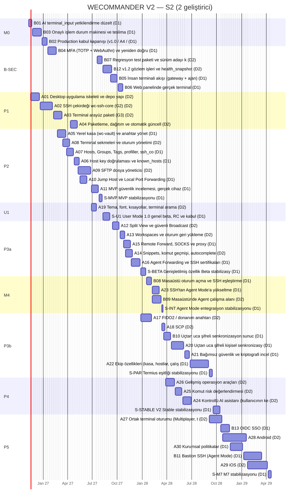
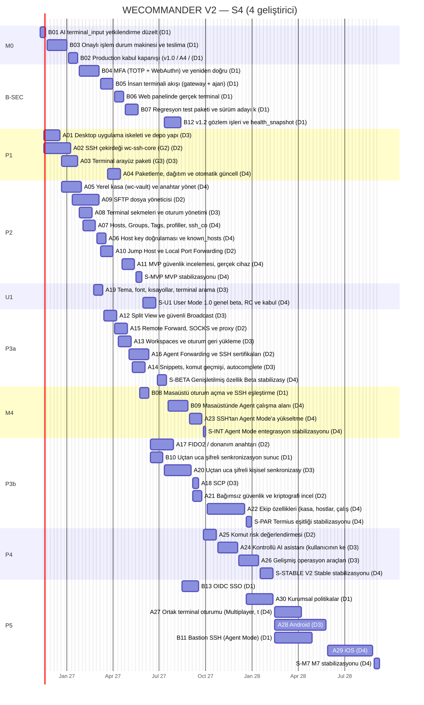
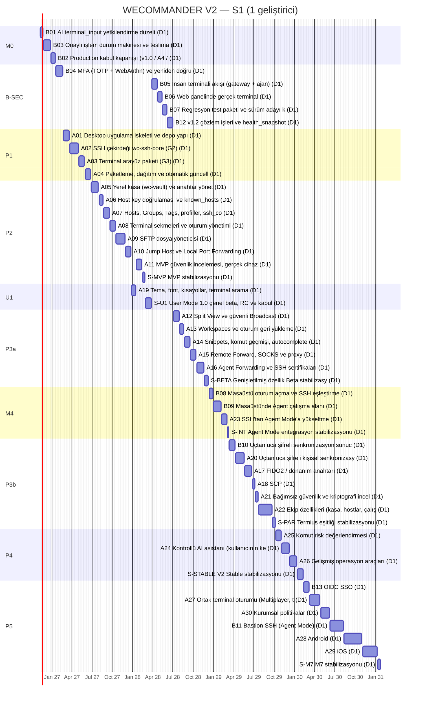

# WECOMMANDER V2 — Geliştirme Takvimi ve Kaynak Senaryoları

- **Sürüm:** v0.2 · **Tarih:** 2026-11-07 · **Planlama başlangıcı:** 2026-11-09 (Pazartesi, W1)
- **Kaynak:** [`WECOMMANDER_V2_MASTER_PLAN.md`](./WECOMMANDER_V2_MASTER_PLAN.md) (43 iş paketi)
- **Hesaplama:** Bu belgedeki bütün tarihler, tablolar ve Gantt diyagramları [`plans/tools/wecommander_v2_scheduler.py`](./tools/wecommander_v2_scheduler.py) ile [`plans/data/wecommander_v2_work_packages.json`](./data/wecommander_v2_work_packages.json) verisinden üretilir. `GENERATED` bölümleri elle düzenlenmez.
- **Varsayılan senaryo:** S2 (iki tam zamanlı geliştirici).
- **Takvimin niteliği:** **Doğrulanacak başlangıç tahminidir, kesin teslimat taahhüdü değildir.** M1 (A01–A03) bitince gerçekleşen eforlarla zorunlu revizyon (R1) yapılır (Master Plan §3.4).

## 1. Hesaplama yöntemi

1. **Paket süresi** = ⌈efor (orta nokta, MH) × hız katsayısı ÷ haftalık etkin kapasite × koordinasyon katsayısı⌉ hafta.
   - Etkin kapasite geliştirici başına 0,8 MH/hafta.
   - Koordinasyon katsayısı S1'de 1,0, S2'de 1,10, S4'te 1,25.
   - Hız katsayısı başlangıçta 1,0; gerçekleşen eforlar girildikçe hesaplanır.
2. **Kulvarlar:** Her kalem tek bir kulvara (geliştiriciye) atanır. Bir kulvar aynı anda tek kalem yürütür ve kuyruğundaki sırayı izler. Kalem; kulvar boşaldığında ve bütün ön koşulları bittiğinde başlar.
3. **Stabilizasyon dönemleri** ayrı kalemlerdir: süreleri sabit hafta olarak tanımlıdır ve yeni özellik içermezler. İlgili kilometre taşının kapsamındaki hiçbir paket stabilizasyon başladıktan sonra geliştirilmez (testle doğrulanır). Diğer kulvarlar sonraki kilometre taşlarının işlerine ayrı branch'lerde devam edebilir; bu işler stabilize edilen sürüme girmez.
4. **İşe alışma:** D1 dışındaki kulvarlar 1 hafta gecikmeyle başlar.
5. **Tampon:** Hedef sürüm tarihi = plan bitişi + ⌈başlangıçtan o haftaya kadar geçen hafta × %15⌉. Oran veri dosyasında yapılandırılabilir.
6. **Kritik yol:** Hedeften geriye doğru, her kalemin başlangıcını belirleyen kalem (bir ön koşul ya da aynı kulvardaki önceki kalem) izlenerek bulunur.
7. **Doğrulama:** Döngüsel bağımlılık, eksik bağımlılık, kulvar çakışması, stabilizasyon ihlali, sürüm tarihinin kapsamdan önce olması ve belgelerle üretilen bölümlerin uyumsuzluğu otomatik testlerle denetlenir.
8. **AI destekli geliştirme** kazancı varsayılmaz; kazanç ortaya çıkarsa R1'de hız katsayısına yansır.

**Eksik kaynak bilgileri (varsayım):**
- Geliştiricilerin deneyim düzeyi eşittir; ek geliştiriciler Rust ve TypeScript bilir.
- Sahip her kilometre taşında production onayı ve gerçek cihaz kabulü için zaman ayırır.
- Apple Developer hesabı kararı U1'den önce verilir.
- Resmî tatiller ve izinler 0,8 etkin kapasite katsayısının içindedir; bayram haftalarında gecikme tamponu kullanılır.

### Yeniden hesaplama

```bash
python3 plans/tools/wecommander_v2_scheduler.py validate
python3 plans/tools/wecommander_v2_scheduler.py render --write
python3 plans/tools/wecommander_v2_scheduler.py check
python3 -m unittest discover -s plans/tools -p 'test_*.py'
```

## 2. Senaryo özeti (kilometre taşları)

<!-- GENERATED:BEGIN milestones -->
| Kilometre taşı | S1 plan | S1 hedef | S2 plan | S2 hedef | S4 plan | S4 hedef |
|---|---|---|---|---|---|---|
| **M0** Agent Mode güvenlik ve production kapanışı | 2027-01-15 | 2027-01-29 | 2027-01-15 | 2027-01-29 | 2027-01-22 | 2027-02-05 |
| **M1** Çalışan User Mode SSH prototipi | 2027-05-28 | 2027-07-02 | 2027-03-12 | 2027-04-02 | 2027-01-22 | 2027-02-05 |
| **M2** User Mode kullanılabilir MVP | 2028-02-25 | 2028-05-12 | 2027-08-06 | 2027-09-17 | 2027-05-28 | 2027-07-02 |
| **U1** User Mode 1.0 Stable | 2028-03-24 | 2028-06-09 | 2027-09-03 | 2027-10-22 | 2027-06-25 | 2027-07-30 |
| **M3** Genişletilmiş özellik Beta'sı (User Mode 1.x, 3 işletim sistemi) | 2028-12-08 | 2029-04-06 | 2028-01-14 | 2028-03-24 | 2027-07-16 | 2027-08-27 |
| **M4** Agent Mode entegrasyonu | 2029-03-09 | 2029-07-20 | 2028-03-17 | 2028-06-02 | 2027-10-01 | 2027-11-26 |
| **M5** Termius masaüstü özellik eşitliği | 2029-10-05 | 2030-03-15 | 2028-09-15 | 2028-12-29 | 2027-12-31 | 2028-03-03 |
| **M6** WECOMMANDER V2 Stable | 2030-02-08 | 2030-08-09 | 2028-10-13 | 2029-02-02 | 2028-02-11 | 2028-04-21 |
| **M7** Mobil ve kurumsal genişleme | 2031-01-24 | 2031-09-12 | 2029-04-20 | 2029-09-07 | 2028-09-08 | 2028-12-22 |
<!-- GENERATED:END milestones -->

## 3. Aşama tabloları

Aşamalar paralel yürüdüğü için tarihleri örtüşebilir. "Efor", aşamadaki paketlerin koordinasyon öncesi orta nokta toplamıdır.

<!-- GENERATED:BEGIN phases -->

#### S1 (1 geliştirici)

| Aşama | Başlangıç | Plan bitişi | Süre (hafta) | Efor (MH) | Hedef (tampon dahil) |
|---|---|---|---|---|---|
| Agent Mode güvenlik ve production kapanışı | 2026-11-09 | 2027-01-15 | 10 | 6,5 | 2027-01-29 |
| Agent Mode güvenlik, terminal ve gözlem | 2027-01-18 | 2028-06-30 | 76 | 12,75 | 2028-09-29 |
| Aşama 1 — Masaüstü temel altyapısı (M1: A01–A03) | 2027-02-22 | 2027-06-25 | 18 | 13 | 2027-07-30 |
| Aşama 2 — SSH MVP (M2) | 2027-06-28 | 2028-02-25 | 35 | 19,75 | 2028-05-12 |
| User Mode 1.0 Stable (U1) | 2027-12-27 | 2028-03-24 | 13 | 1,75 | 2028-06-09 |
| Aşama 3a — Genişletilmiş özellik Beta'sı (M3) | 2028-07-03 | 2028-12-08 | 23 | 13 | 2029-04-06 |
| Agent Mode entegrasyonu (M4) | 2028-12-11 | 2029-03-09 | 13 | 7,75 | 2029-07-20 |
| Aşama 3b — Termius eşitliği (M5) | 2029-03-12 | 2029-10-05 | 30 | 20,5 | 2030-03-15 |
| Aşama 4 — Farklılaştırıcılar ve V2 Stable (M6) | 2029-10-08 | 2030-02-08 | 18 | 9,5 | 2030-08-09 |
| Aşama 5 — Mobil ve kurumsal (M7) | 2030-02-11 | 2031-01-24 | 50 | 36,5 | 2031-09-12 |

#### S2 (2 geliştirici)

| Aşama | Başlangıç | Plan bitişi | Süre (hafta) | Efor (MH) | Hedef (tampon dahil) |
|---|---|---|---|---|---|
| Agent Mode güvenlik ve production kapanışı | 2026-11-09 | 2027-01-15 | 10 | 6,5 | 2027-01-29 |
| Agent Mode güvenlik, terminal ve gözlem | 2027-01-18 | 2027-10-22 | 40 | 12,75 | 2027-12-17 |
| Aşama 1 — Masaüstü temel altyapısı (M1: A01–A03) | 2026-11-16 | 2027-05-07 | 25 | 13 | 2027-06-04 |
| Aşama 2 — SSH MVP (M2) | 2027-02-22 | 2027-08-06 | 24 | 19,75 | 2027-09-17 |
| User Mode 1.0 Stable (U1) | 2027-06-28 | 2027-09-03 | 10 | 1,75 | 2027-10-22 |
| Aşama 3a — Genişletilmiş özellik Beta'sı (M3) | 2027-09-13 | 2028-01-14 | 18 | 13 | 2028-03-24 |
| Agent Mode entegrasyonu (M4) | 2028-01-17 | 2028-03-17 | 9 | 7,75 | 2028-06-02 |
| Aşama 3b — Termius eşitliği (M5) | 2027-12-27 | 2028-09-15 | 38 | 20,5 | 2028-12-29 |
| Aşama 4 — Farklılaştırıcılar ve V2 Stable (M6) | 2028-03-27 | 2028-10-13 | 29 | 9,5 | 2029-02-02 |
| Aşama 5 — Mobil ve kurumsal (M7) | 2028-09-04 | 2029-04-20 | 33 | 36,5 | 2029-09-07 |

#### S4 (4 geliştirici)

| Aşama | Başlangıç | Plan bitişi | Süre (hafta) | Efor (MH) | Hedef (tampon dahil) |
|---|---|---|---|---|---|
| Agent Mode güvenlik ve production kapanışı | 2026-11-09 | 2027-01-22 | 11 | 6,5 | 2027-02-05 |
| Agent Mode güvenlik, terminal ve gözlem | 2027-01-25 | 2027-08-13 | 29 | 12,75 | 2027-09-24 |
| Aşama 1 — Masaüstü temel altyapısı (M1: A01–A03) | 2026-11-16 | 2027-04-16 | 22 | 13 | 2027-05-14 |
| Aşama 2 — SSH MVP (M2) | 2026-12-21 | 2027-05-28 | 23 | 19,75 | 2027-07-02 |
| User Mode 1.0 Stable (U1) | 2027-02-22 | 2027-06-25 | 18 | 1,75 | 2027-07-30 |
| Aşama 3a — Genişletilmiş özellik Beta'sı (M3) | 2027-03-15 | 2027-07-16 | 18 | 13 | 2027-08-27 |
| Agent Mode entegrasyonu (M4) | 2027-05-24 | 2027-10-01 | 19 | 7,75 | 2027-11-26 |
| Aşama 3b — Termius eşitliği (M5) | 2027-06-14 | 2027-12-31 | 29 | 20,5 | 2028-03-03 |
| Aşama 4 — Farklılaştırıcılar ve V2 Stable (M6) | 2027-09-27 | 2028-02-11 | 20 | 9,5 | 2028-04-21 |
| Aşama 5 — Mobil ve kurumsal (M7) | 2027-08-16 | 2028-09-08 | 56 | 36,5 | 2028-12-22 |
<!-- GENERATED:END phases -->

## 4. Kritik yol

<!-- GENERATED:BEGIN critical -->
| Senaryo | Kritik yol: User Mode 1.0 Stable | Kritik yol: V2 Stable |
|---|---|---|
| S1 | B01 → B03 → B02 → B04 → A01 → A02 → A03 → A04 → A05 → A06 → A07 → A08 → A09 → A10 → A19 → A11 → S-MVP → S-U1 | B01 → B03 → B02 → B04 → A01 → A02 → A03 → A04 → A05 → A06 → A07 → A08 → A09 → A10 → A19 → A11 → S-MVP → S-U1 → B05 → B06 → B07 → B12 → A12 → A13 → A14 → A15 → A16 → S-BETA → B08 → B09 → A23 → S-INT → B10 → A20 → A17 → A18 → A21 → A22 → S-PAR → A25 → A24 → A26 → S-STABLE |
| S2 | A01 → A02 → A03 → A08 → A04 → A09 → A11 → S-MVP → S-U1 | A01 → A02 → A03 → A08 → A04 → A09 → A11 → S-MVP → S-U1 → B05 → B06 → A15 → A16 → S-BETA → B08 → B09 → S-INT → B10 → A20 → A21 → A22 → S-PAR → S-STABLE |
| S4 | A01 → A05 → A07 → A06 → A04 → A11 → S-MVP → S-U1 | B01 → B03 → B02 → B04 → B05 → B06 → B07 → B08 → B10 → A20 → A21 → A25 → A24 → A26 → S-STABLE |
<!-- GENERATED:END critical -->

## 5. Gantt diyagramları

### 5.1 S2 (varsayılan senaryo)

<!-- GENERATED:BEGIN gantt-S2 -->

<!-- GENERATED:END gantt-S2 -->

### 5.2 S4

<!-- GENERATED:BEGIN gantt-S4 -->

<!-- GENERATED:END gantt-S4 -->

### 5.3 S1

<!-- GENERATED:BEGIN gantt-S1 -->

<!-- GENERATED:END gantt-S1 -->

## 6. Haftalık geliştirme takvimi (S2)

"—" boş kulvar demektir: geliştirici ön koşul bekler veya kod incelemesi, destek, regresyon ve hata düzeltmesine ayrılır. `S-` ile başlayan kalemler stabilizasyon dönemleridir.

<!-- GENERATED:BEGIN weekly -->
| Hafta | Pazartesi | D1 | D2 |
|---|---|---|---|
| W1 | 2026-11-09 | B01 | — |
| W2 | 2026-11-16 | B01 | A01 |
| W3 | 2026-11-23 | B03 | A01 |
| W4 | 2026-11-30 | B03 | A01 |
| W5 | 2026-12-07 | B03 | A01 |
| W6 | 2026-12-14 | B03 | A01 |
| W7 | 2026-12-21 | B03 | A02 |
| W8 | 2026-12-28 | B02 | A02 |
| W9 | 2027-01-04 | B02 | A02 |
| W10 | 2027-01-11 | B02 | A02 |
| W11 | 2027-01-18 | B04 | A02 |
| W12 | 2027-01-25 | B04 | A02 |
| W13 | 2027-02-01 | B04 | A02 |
| W14 | 2027-02-08 | B04 | A03 |
| W15 | 2027-02-15 | B04 | A03 |
| W16 | 2027-02-22 | A05 | A03 |
| W17 | 2027-03-01 | A05 | A03 |
| W18 | 2027-03-08 | A05 | A03 |
| W19 | 2027-03-15 | A05 | A08 |
| W20 | 2027-03-22 | A05 | A08 |
| W21 | 2027-03-29 | A07 | A08 |
| W22 | 2027-04-05 | A07 | A08 |
| W23 | 2027-04-12 | A07 | A04 |
| W24 | 2027-04-19 | A07 | A04 |
| W25 | 2027-04-26 | A06 | A04 |
| W26 | 2027-05-03 | A06 | A04 |
| W27 | 2027-05-10 | A06 | A09 |
| W28 | 2027-05-17 | A10 | A09 |
| W29 | 2027-05-24 | A10 | A09 |
| W30 | 2027-05-31 | A10 | A09 |
| W31 | 2027-06-07 | A10 | A09 |
| W32 | 2027-06-14 | — | A09 |
| W33 | 2027-06-21 | — | A09 |
| W34 | 2027-06-28 | A11 | A19 |
| W35 | 2027-07-05 | A11 | A19 |
| W36 | 2027-07-12 | A11 | A19 |
| W37 | 2027-07-19 | A11 | B07 |
| W38 | 2027-07-26 | S-MVP | B07 |
| W39 | 2027-08-02 | S-MVP | B07 |
| W40 | 2027-08-09 | S-U1 | B12 |
| W41 | 2027-08-16 | S-U1 | B12 |
| W42 | 2027-08-23 | S-U1 | B12 |
| W43 | 2027-08-30 | S-U1 | B12 |
| W44 | 2027-09-06 | B05 | B12 |
| W45 | 2027-09-13 | B05 | A12 |
| W46 | 2027-09-20 | B05 | A12 |
| W47 | 2027-09-27 | B05 | A12 |
| W48 | 2027-10-04 | B06 | A12 |
| W49 | 2027-10-11 | B06 | A13 |
| W50 | 2027-10-18 | B06 | A13 |
| W51 | 2027-10-25 | A15 | A13 |
| W52 | 2027-11-01 | A15 | A14 |
| W53 | 2027-11-08 | A15 | A14 |
| W54 | 2027-11-15 | A15 | A14 |
| W55 | 2027-11-22 | A16 | A14 |
| W56 | 2027-11-29 | A16 | — |
| W57 | 2027-12-06 | A16 | — |
| W58 | 2027-12-13 | A16 | — |
| W59 | 2027-12-20 | A16 | — |
| W60 | 2027-12-27 | S-BETA | A17 |
| W61 | 2028-01-03 | S-BETA | A17 |
| W62 | 2028-01-10 | S-BETA | A17 |
| W63 | 2028-01-17 | B08 | A17 |
| W64 | 2028-01-24 | B08 | A17 |
| W65 | 2028-01-31 | B08 | A17 |
| W66 | 2028-02-07 | A23 | B09 |
| W67 | 2028-02-14 | A23 | B09 |
| W68 | 2028-02-21 | A23 | B09 |
| W69 | 2028-02-28 | A23 | B09 |
| W70 | 2028-03-06 | — | B09 |
| W71 | 2028-03-13 | S-INT | A18 |
| W72 | 2028-03-20 | B10 | A18 |
| W73 | 2028-03-27 | B10 | A26 |
| W74 | 2028-04-03 | B10 | A26 |
| W75 | 2028-04-10 | B10 | A26 |
| W76 | 2028-04-17 | A20 | A26 |
| W77 | 2028-04-24 | A20 | A26 |
| W78 | 2028-05-01 | A20 | A25 |
| W79 | 2028-05-08 | A20 | A25 |
| W80 | 2028-05-15 | A20 | A25 |
| W81 | 2028-05-22 | A20 | A25 |
| W82 | 2028-05-29 | A20 | A24 |
| W83 | 2028-06-05 | A21 | A24 |
| W84 | 2028-06-12 | A21 | A24 |
| W85 | 2028-06-19 | A21 | A24 |
| W86 | 2028-06-26 | A22 | A24 |
| W87 | 2028-07-03 | A22 | — |
| W88 | 2028-07-10 | A22 | — |
| W89 | 2028-07-17 | A22 | — |
| W90 | 2028-07-24 | A22 | — |
| W91 | 2028-07-31 | A22 | — |
| W92 | 2028-08-07 | A22 | — |
| W93 | 2028-08-14 | A22 | — |
| W94 | 2028-08-21 | A22 | — |
| W95 | 2028-08-28 | A22 | — |
| W96 | 2028-09-04 | S-PAR | A27 |
| W97 | 2028-09-11 | S-PAR | A27 |
| W98 | 2028-09-18 | S-STABLE | A27 |
| W99 | 2028-09-25 | S-STABLE | A27 |
| W100 | 2028-10-02 | S-STABLE | A27 |
| W101 | 2028-10-09 | S-STABLE | A27 |
| W102 | 2028-10-16 | B13 | A27 |
| W103 | 2028-10-23 | B13 | A28 |
| W104 | 2028-10-30 | B13 | A28 |
| W105 | 2028-11-06 | B13 | A28 |
| W106 | 2028-11-13 | B13 | A28 |
| W107 | 2028-11-20 | A30 | A28 |
| W108 | 2028-11-27 | A30 | A28 |
| W109 | 2028-12-04 | A30 | A28 |
| W110 | 2028-12-11 | A30 | A28 |
| W111 | 2028-12-18 | A30 | A28 |
| W112 | 2028-12-25 | A30 | A28 |
| W113 | 2029-01-01 | A30 | A28 |
| W114 | 2029-01-08 | B11 | A28 |
| W115 | 2029-01-15 | B11 | A28 |
| W116 | 2029-01-22 | B11 | A29 |
| W117 | 2029-01-29 | B11 | A29 |
| W118 | 2029-02-05 | B11 | A29 |
| W119 | 2029-02-12 | B11 | A29 |
| W120 | 2029-02-19 | B11 | A29 |
| W121 | 2029-02-26 | B11 | A29 |
| W122 | 2029-03-05 | B11 | A29 |
| W123 | 2029-03-12 | B11 | A29 |
| W124 | 2029-03-19 | — | A29 |
| W125 | 2029-03-26 | — | A29 |
| W126 | 2029-04-02 | — | A29 |
| W127 | 2029-04-09 | S-M7 | — |
| W128 | 2029-04-16 | S-M7 | — |
<!-- GENERATED:END weekly -->

## 7. Aylık yol haritası (S2)

<!-- GENERATED:BEGIN monthly -->
| Ay | D1 | D2 |
|---|---|---|
| 2026-11 | B01, B03 | A01 |
| 2026-12 | B02, B03 | A01, A02 |
| 2027-01 | B02, B04 | A02 |
| 2027-02 | A05, B04 | A02, A03 |
| 2027-03 | A05, A07 | A03, A08 |
| 2027-04 | A06, A07 | A04, A08 |
| 2027-05 | A06, A10 | A04, A09 |
| 2027-06 | A10, A11 | A09, A19 |
| 2027-07 | A11, S-MVP | A19, B07 |
| 2027-08 | S-MVP, S-U1 | B07, B12 |
| 2027-09 | B05 | A12, B12 |
| 2027-10 | A15, B06 | A12, A13 |
| 2027-11 | A15, A16 | A14 |
| 2027-12 | A16, S-BETA | A17 |
| 2028-01 | B08, S-BETA | A17 |
| 2028-02 | A23 | B09 |
| 2028-03 | B10, S-INT | A18, A26, B09 |
| 2028-04 | A20, B10 | A26 |
| 2028-05 | A20 | A24, A25 |
| 2028-06 | A21, A22 | A24 |
| 2028-07 | A22 | — |
| 2028-08 | A22 | — |
| 2028-09 | S-PAR, S-STABLE | A27 |
| 2028-10 | B13, S-STABLE | A27, A28 |
| 2028-11 | A30, B13 | A28 |
| 2028-12 | A30 | A28 |
| 2029-01 | A30, B11 | A28, A29 |
| 2029-02 | B11 | A29 |
| 2029-03 | B11 | A29 |
| 2029-04 | S-M7 | A29 |
<!-- GENERATED:END monthly -->

## 8. Paralel geliştirme matrisi (S2, çeyrek bazında)

<!-- GENERATED:BEGIN parallel -->
| Çeyrek | D1 (Agent Mode + Rust çekirdek/kasa/tüneller + sürüm sorumlusu) | D2 (Masaüstü, arayüz, SFTP, entegrasyon) |
|---|---|---|
| 2026 Ç4 | B01, B03, B02 | A01, A02 |
| 2027 Ç1 | B02, B04, A05, A07 | A02, A03, A08 |
| 2027 Ç2 | A07, A06, A10, A11 | A08, A04, A09, A19 |
| 2027 Ç3 | A11, S-MVP, S-U1, B05 | A19, B07, B12, A12 |
| 2027 Ç4 | B06, A15, A16, S-BETA | A12, A13, A14, A17 |
| 2028 Ç1 | S-BETA, B08, A23, S-INT, B10 | A17, B09, A18, A26 |
| 2028 Ç2 | B10, A20, A21, A22 | A26, A25, A24 |
| 2028 Ç3 | A22, S-PAR, S-STABLE | A27 |
| 2028 Ç4 | S-STABLE, B13, A30 | A27, A28 |
| 2029 Ç1 | A30, B11 | A28, A29 |
| 2029 Ç2 | S-M7 | A29 |
<!-- GENERATED:END parallel -->

**Aynı anda yürütülmemesi gerekenler (bağımlılıkla zorunlu kılındı):**
- B01 ile B03: aynı onay yüzeyi; B03, B01'e bağlı.
- A20 ile A22: aynı kripto modeli; araya dış inceleme (A21) girer.
- B04 ile B05: aynı kimlik doğrulama yüzeyi.
- A05'in kasa biçimi dondurulmadan A20 başlamaz.

## 9. Sürüm takvimi (S2)

<!-- GENERATED:BEGIN releases -->
| Sürüm | Kilometre taşı | Plan (S2) | Hedef (S2) | Kanal |
|---|---|---|---|---|
| Agent Mode v1.0 | M0 | 2027-01-15 | 2027-01-29 | production (promote-production) |
| Desktop 0.1 prototip | M1 | 2027-03-12 | 2027-04-02 | dahili |
| Desktop 0.5 MVP | M2 | 2027-08-06 | 2027-09-17 | davetli erken erişim |
| **User Mode 1.0 Stable** | U1 | 2027-09-03 | 2027-10-22 | stable (Windows, macOS, Linux) |
| User Mode 1.x Beta | M3 | 2028-01-14 | 2028-03-24 | beta kanalı |
| Desktop 1.x + Agent Mode entegrasyonu | M4 | 2028-03-17 | 2028-06-02 | beta → stable |
| Termius eşitliği RC | M5 | 2028-09-15 | 2028-12-29 | sürüm adayı |
| **WECOMMANDER V2.0 Stable** | M6 | 2028-10-13 | 2029-02-02 | stable |
| V2.1 mobil ve kurumsal | M7 | 2029-04-20 | 2029-09-07 | stable + mobil test kanalları |
| Agent Mode v1.1 (MFA) | — | 2027-02-19 | 2027-03-12 | production |
| Agent Mode v1.2 (web terminali) | — | 2027-10-22 | 2027-12-17 | production |
| Agent Mode v1.3 (gözlem) | — | 2027-09-10 | 2027-10-29 | production |
<!-- GENERATED:END releases -->

## 10. Eski (v0.1) ve yeni (v0.2) takvim karşılaştırması

<!-- GENERATED:BEGIN baseline -->
| Senaryo | Kilometre taşı | v0.1 plan | v0.2 plan | Fark (hafta) |
|---|---|---|---|---|
| S1 | M0 | 2026-12-25 | 2027-01-15 | +3 |
| S1 | M1 | 2027-04-30 | 2027-05-28 | +4 |
| S1 | M2 | 2027-12-31 | 2028-02-25 | +8 |
| S1 | U1 | — (yeni) | 2028-03-24 | — |
| S1 | M3 | 2028-10-06 | 2028-12-08 | +9 |
| S1 | M4 | 2029-01-05 | 2029-03-09 | +9 |
| S1 | M5 | 2029-08-03 | 2029-10-05 | +9 |
| S1 | M6 | 2029-12-07 | 2030-02-08 | +9 |
| S1 | M7 | 2030-11-22 | 2031-01-24 | +9 |
| S2 | M0 | 2026-12-25 | 2027-01-15 | +3 |
| S2 | M1 | 2027-02-19 | 2027-03-12 | +3 |
| S2 | M2 | 2027-07-09 | 2027-08-06 | +4 |
| S2 | U1 | — (yeni) | 2027-09-03 | — |
| S2 | M3 | 2027-11-19 | 2028-01-14 | +8 |
| S2 | M4 | 2028-01-21 | 2028-03-17 | +8 |
| S2 | M5 | 2028-07-21 | 2028-09-15 | +8 |
| S2 | M6 | 2028-08-18 | 2028-10-13 | +8 |
| S2 | M7 | 2029-02-23 | 2029-04-20 | +8 |
| S4 | M0 | 2026-12-25 | 2027-01-22 | +4 |
| S4 | M1 | 2027-01-08 | 2027-01-22 | +2 |
| S4 | M2 | 2027-05-21 | 2027-05-28 | +1 |
| S4 | U1 | — (yeni) | 2027-06-25 | — |
| S4 | M3 | 2027-06-25 | 2027-07-16 | +3 |
| S4 | M4 | 2027-09-10 | 2027-10-01 | +3 |
| S4 | M5 | 2027-12-10 | 2027-12-31 | +3 |
| S4 | M6 | 2028-01-14 | 2028-02-11 | +4 |
| S4 | M7 | 2028-08-11 | 2028-09-08 | +4 |
<!-- GENERATED:END baseline -->

**Farkların nedenleri:**
1. **B03 büyüdü (1,25 → 3,5 MH)** ve v1.0 kapanışının (B02) ön koşulu olarak kaldı. Bu nedenle M0 birkaç hafta kaydı. Gerekçe: otomatik onay iadesi yerine durum makinesi, ajan tarafı kalıcı işlem günlüğü ve uzlaştırma (Master Plan B03).
2. **A01–A03 eforları +0,5 MH** (G1–G3 doğrulama kapıları). M1 ve sonraki bütün tarihler buna göre kaydı.
3. **Yeni U1 kilometre taşı:** 4 haftalık genel beta/RC/kabul dönemi (`S-U1`) sürüm sorumlusu kulvarını işgal eder. Genişletilmiş özellik Beta'sı (M3) artık U1'den sonra gelir.
4. **A11'e kullanıcı belgeleri eklendi (+0,5 MH); A19 U1'e taşındı.** A19, S2'de SFTP'nin hemen ardından yapılır.
5. **health_snapshot düzeltmesi B03'ten B12'ye taşındı (+0,5 MH B12).**
6. **Model düzeltmeleri:**
   - Hesaplama artık tek kaynaktan yapılıyor; v0.1'de milestone tabloları, Gantt ve haftalık tablo ayrı betik adımlarında üretiliyordu.
   - v0.1'de bir tablodaki birikimli tampon ve elle yazılmış birkaç tarih (paralel matris, sürüm takvimi) üretilen veriden bağımsızdı; artık hepsi üretiliyor ve testle denetleniyor.
   - Kulvar sıraları ve bağımlılıklar veri dosyasına alındı.

## 11. Toplam kapasite ihtiyacı

<!-- GENERATED:BEGIN capacity -->
| Senaryo | Efor × koordinasyon | Takvim (hafta) | Kapasite | Kullanım | User Mode 1.0 (plan / hedef) | V2 Stable (plan / hedef) |
|---|---|---|---|---|---|---|
| S1 | 141 MH | 220 | 176 MH | %80 | 2028-03-24 / 2028-06-09 | 2030-02-08 / 2030-08-09 |
| S2 | 155,1 MH | 128 | 204,8 MH | %76 | 2027-09-03 / 2027-10-22 | 2028-10-13 / 2029-02-02 |
| S4 | 176,25 MH | 96 | 307,2 MH | %57 | 2027-06-25 / 2027-07-30 | 2028-02-11 / 2028-04-21 |
<!-- GENERATED:END capacity -->

S4'teki düşük kullanım beklenen bir sonuçtur: bağımlılık zinciri dört kulvarı her zaman dolduramıyor. Boş haftalar regresyon, dokümantasyon ve hata düzeltmesine ayrılır. Dörtten fazla geliştirici takvimi kayda değer biçimde kısaltmaz.

## 12. Risk ve gecikme senaryoları

| Senaryo | Olasılık | Etki | Gecikme tahmini | Azaltma |
|---|---|---|---|---|
| `russh-sftp` yetersiz; SFTP katmanı yazılır (G2) | Orta | A09 kritik yolda | A09'a +2 MH; MVP ve U1 yaklaşık +3 hafta | G2'de 2 günlük teknik deneme; sonuç R1'de `reestimates` alanına girer |
| Linux WebKitGTK'de xterm.js yavaş (G3) | Orta | Linux U1 | A08'e +1 MH; gerekirse Linux U1 "beta" etiketiyle | Çizici düşürme |
| Hız katsayısı R1'de 1,3'ün üstünde | Orta | Bütün takvim | Kalan işler orantılı uzar | Sahip kapsam veya kaynak kararı verir |
| A21 dış incelemede kritik bulgu | Orta | Ekip kasası | M5 +4–8 hafta | A20 öncesi tasarım ön incelemesi |
| B03 hata enjeksiyon testleri beklenenden zor | Orta | M0 | +2–3 hafta | Uzun görevler ilk dilimin dışında bırakılabilir; kural (kanıt yoksa iade yok) değişmez |
| Apple hesabı kararı gecikir | Orta | macOS U1 | macOS U1 gecikir; Windows ve Linux etkilenmez | Karar M2'den önce |
| Bir geliştirici bir ay ayrılır | Orta | Kulvar durur | İlgili kulvarda +5 hafta | Paketler bağımsız PR'larla biter |
| Termius'un yeni özellik çıkarması | Yüksek | Kapsam baskısı | Planlanmaz | Değişiklik yalnız kilometre taşı sınırında kabul edilir |

## Ek A — Kalem bazında takvim (üç senaryo)

<!-- GENERATED:BEGIN wp-schedule -->

#### S1 (1 geliştirici)

Efor × koordinasyon × hız = 141 MH; kapasite 1 × 220 hafta × 0,8 = 176 MH; kullanım ≈ %80.

| Kalem | Tür | Kulvar | Başlangıç | Bitiş | Hafta |
|---|---|---|---|---|---|
| B01 | paket | D1 | 2026-11-09 | 2026-11-20 | 2 |
| B03 | paket | D1 | 2026-11-23 | 2026-12-25 | 5 |
| B02 | paket | D1 | 2026-12-28 | 2027-01-15 | 3 |
| B04 | paket | D1 | 2027-01-18 | 2027-02-19 | 5 |
| A01 | paket | D1 | 2027-02-22 | 2027-03-19 | 4 |
| A02 | paket | D1 | 2027-03-22 | 2027-04-30 | 6 |
| A03 | paket | D1 | 2027-05-03 | 2027-05-28 | 4 |
| A04 | paket | D1 | 2027-05-31 | 2027-06-25 | 4 |
| A05 | paket | D1 | 2027-06-28 | 2027-07-30 | 5 |
| A06 | paket | D1 | 2027-08-02 | 2027-08-20 | 3 |
| A07 | paket | D1 | 2027-08-23 | 2027-09-17 | 4 |
| A08 | paket | D1 | 2027-09-20 | 2027-10-15 | 4 |
| A09 | paket | D1 | 2027-10-18 | 2027-11-26 | 6 |
| A10 | paket | D1 | 2027-11-29 | 2027-12-24 | 4 |
| A19 | paket | D1 | 2027-12-27 | 2028-01-14 | 3 |
| A11 | paket | D1 | 2028-01-17 | 2028-02-11 | 4 |
| S-MVP | stabilizasyon | D1 | 2028-02-14 | 2028-02-25 | 2 |
| S-U1 | stabilizasyon | D1 | 2028-02-28 | 2028-03-24 | 4 |
| B05 | paket | D1 | 2028-03-27 | 2028-04-21 | 4 |
| B06 | paket | D1 | 2028-04-24 | 2028-05-12 | 3 |
| B07 | paket | D1 | 2028-05-15 | 2028-06-02 | 3 |
| B12 | paket | D1 | 2028-06-05 | 2028-06-30 | 4 |
| A12 | paket | D1 | 2028-07-03 | 2028-07-28 | 4 |
| A13 | paket | D1 | 2028-07-31 | 2028-08-18 | 3 |
| A14 | paket | D1 | 2028-08-21 | 2028-09-15 | 4 |
| A15 | paket | D1 | 2028-09-18 | 2028-10-13 | 4 |
| A16 | paket | D1 | 2028-10-16 | 2028-11-17 | 5 |
| S-BETA | stabilizasyon | D1 | 2028-11-20 | 2028-12-08 | 3 |
| B08 | paket | D1 | 2028-12-11 | 2028-12-29 | 3 |
| B09 | paket | D1 | 2029-01-01 | 2029-02-02 | 5 |
| A23 | paket | D1 | 2029-02-05 | 2029-03-02 | 4 |
| S-INT | stabilizasyon | D1 | 2029-03-05 | 2029-03-09 | 1 |
| B10 | paket | D1 | 2029-03-12 | 2029-04-06 | 4 |
| A20 | paket | D1 | 2029-04-09 | 2029-05-18 | 6 |
| A17 | paket | D1 | 2029-05-21 | 2029-06-22 | 5 |
| A18 | paket | D1 | 2029-06-25 | 2029-07-06 | 2 |
| A21 | paket | D1 | 2029-07-09 | 2029-07-20 | 2 |
| A22 | paket | D1 | 2029-07-23 | 2029-09-21 | 9 |
| S-PAR | stabilizasyon | D1 | 2029-09-24 | 2029-10-05 | 2 |
| A25 | paket | D1 | 2029-10-08 | 2029-11-02 | 4 |
| A24 | paket | D1 | 2029-11-05 | 2029-12-07 | 5 |
| A26 | paket | D1 | 2029-12-10 | 2030-01-11 | 5 |
| S-STABLE | stabilizasyon | D1 | 2030-01-14 | 2030-02-08 | 4 |
| B13 | paket | D1 | 2030-02-11 | 2030-03-08 | 4 |
| A27 | paket | D1 | 2030-03-11 | 2030-04-26 | 7 |
| A30 | paket | D1 | 2030-04-29 | 2030-06-07 | 6 |
| B11 | paket | D1 | 2030-06-10 | 2030-08-09 | 9 |
| A28 | paket | D1 | 2030-08-12 | 2030-11-01 | 12 |
| A29 | paket | D1 | 2030-11-04 | 2031-01-10 | 10 |
| S-M7 | stabilizasyon | D1 | 2031-01-13 | 2031-01-24 | 2 |

#### S2 (2 geliştirici)

Efor × koordinasyon × hız = 155,1 MH; kapasite 2 × 128 hafta × 0,8 = 204,8 MH; kullanım ≈ %76.

| Kalem | Tür | Kulvar | Başlangıç | Bitiş | Hafta |
|---|---|---|---|---|---|
| B01 | paket | D1 | 2026-11-09 | 2026-11-20 | 2 |
| A01 | paket | D2 | 2026-11-16 | 2026-12-18 | 5 |
| B03 | paket | D1 | 2026-11-23 | 2026-12-25 | 5 |
| A02 | paket | D2 | 2026-12-21 | 2027-02-05 | 7 |
| B02 | paket | D1 | 2026-12-28 | 2027-01-15 | 3 |
| B04 | paket | D1 | 2027-01-18 | 2027-02-19 | 5 |
| A03 | paket | D2 | 2027-02-08 | 2027-03-12 | 5 |
| A05 | paket | D1 | 2027-02-22 | 2027-03-26 | 5 |
| A08 | paket | D2 | 2027-03-15 | 2027-04-09 | 4 |
| A07 | paket | D1 | 2027-03-29 | 2027-04-23 | 4 |
| A04 | paket | D2 | 2027-04-12 | 2027-05-07 | 4 |
| A06 | paket | D1 | 2027-04-26 | 2027-05-14 | 3 |
| A09 | paket | D2 | 2027-05-10 | 2027-06-25 | 7 |
| A10 | paket | D1 | 2027-05-17 | 2027-06-11 | 4 |
| A11 | paket | D1 | 2027-06-28 | 2027-07-23 | 4 |
| A19 | paket | D2 | 2027-06-28 | 2027-07-16 | 3 |
| B07 | paket | D2 | 2027-07-19 | 2027-08-06 | 3 |
| S-MVP | stabilizasyon | D1 | 2027-07-26 | 2027-08-06 | 2 |
| S-U1 | stabilizasyon | D1 | 2027-08-09 | 2027-09-03 | 4 |
| B12 | paket | D2 | 2027-08-09 | 2027-09-10 | 5 |
| B05 | paket | D1 | 2027-09-06 | 2027-10-01 | 4 |
| A12 | paket | D2 | 2027-09-13 | 2027-10-08 | 4 |
| B06 | paket | D1 | 2027-10-04 | 2027-10-22 | 3 |
| A13 | paket | D2 | 2027-10-11 | 2027-10-29 | 3 |
| A15 | paket | D1 | 2027-10-25 | 2027-11-19 | 4 |
| A14 | paket | D2 | 2027-11-01 | 2027-11-26 | 4 |
| A16 | paket | D1 | 2027-11-22 | 2027-12-24 | 5 |
| S-BETA | stabilizasyon | D1 | 2027-12-27 | 2028-01-14 | 3 |
| A17 | paket | D2 | 2027-12-27 | 2028-02-04 | 6 |
| B08 | paket | D1 | 2028-01-17 | 2028-02-04 | 3 |
| A23 | paket | D1 | 2028-02-07 | 2028-03-03 | 4 |
| B09 | paket | D2 | 2028-02-07 | 2028-03-10 | 5 |
| S-INT | stabilizasyon | D1 | 2028-03-13 | 2028-03-17 | 1 |
| A18 | paket | D2 | 2028-03-13 | 2028-03-24 | 2 |
| B10 | paket | D1 | 2028-03-20 | 2028-04-14 | 4 |
| A26 | paket | D2 | 2028-03-27 | 2028-04-28 | 5 |
| A20 | paket | D1 | 2028-04-17 | 2028-06-02 | 7 |
| A25 | paket | D2 | 2028-05-01 | 2028-05-26 | 4 |
| A24 | paket | D2 | 2028-05-29 | 2028-06-30 | 5 |
| A21 | paket | D1 | 2028-06-05 | 2028-06-23 | 3 |
| A22 | paket | D1 | 2028-06-26 | 2028-09-01 | 10 |
| S-PAR | stabilizasyon | D1 | 2028-09-04 | 2028-09-15 | 2 |
| A27 | paket | D2 | 2028-09-04 | 2028-10-20 | 7 |
| S-STABLE | stabilizasyon | D1 | 2028-09-18 | 2028-10-13 | 4 |
| B13 | paket | D1 | 2028-10-16 | 2028-11-17 | 5 |
| A28 | paket | D2 | 2028-10-23 | 2029-01-19 | 13 |
| A30 | paket | D1 | 2028-11-20 | 2029-01-05 | 7 |
| B11 | paket | D1 | 2029-01-08 | 2029-03-16 | 10 |
| A29 | paket | D2 | 2029-01-22 | 2029-04-06 | 11 |
| S-M7 | stabilizasyon | D1 | 2029-04-09 | 2029-04-20 | 2 |

#### S4 (4 geliştirici)

Efor × koordinasyon × hız = 176,25 MH; kapasite 4 × 96 hafta × 0,8 = 307,2 MH; kullanım ≈ %57.

| Kalem | Tür | Kulvar | Başlangıç | Bitiş | Hafta |
|---|---|---|---|---|---|
| B01 | paket | D1 | 2026-11-09 | 2026-11-20 | 2 |
| A02 | paket | D2 | 2026-11-16 | 2027-01-08 | 8 |
| A01 | paket | D3 | 2026-11-16 | 2026-12-18 | 5 |
| B03 | paket | D1 | 2026-11-23 | 2027-01-01 | 6 |
| A03 | paket | D3 | 2026-12-21 | 2027-01-22 | 5 |
| A05 | paket | D4 | 2026-12-21 | 2027-01-29 | 6 |
| B02 | paket | D1 | 2027-01-04 | 2027-01-22 | 3 |
| A09 | paket | D2 | 2027-01-11 | 2027-03-05 | 8 |
| B04 | paket | D1 | 2027-01-25 | 2027-03-05 | 6 |
| A08 | paket | D3 | 2027-01-25 | 2027-02-19 | 4 |
| A07 | paket | D4 | 2027-02-01 | 2027-02-26 | 4 |
| A19 | paket | D3 | 2027-02-22 | 2027-03-12 | 3 |
| A06 | paket | D4 | 2027-03-01 | 2027-03-19 | 3 |
| B05 | paket | D1 | 2027-03-08 | 2027-04-02 | 4 |
| A10 | paket | D2 | 2027-03-08 | 2027-04-02 | 4 |
| A12 | paket | D3 | 2027-03-15 | 2027-04-09 | 4 |
| A04 | paket | D4 | 2027-03-22 | 2027-04-16 | 4 |
| B06 | paket | D1 | 2027-04-05 | 2027-04-23 | 3 |
| A15 | paket | D2 | 2027-04-05 | 2027-04-30 | 4 |
| A13 | paket | D3 | 2027-04-12 | 2027-05-07 | 4 |
| A11 | paket | D4 | 2027-04-19 | 2027-05-14 | 4 |
| B07 | paket | D1 | 2027-04-26 | 2027-05-21 | 4 |
| A16 | paket | D2 | 2027-05-03 | 2027-06-11 | 6 |
| A14 | paket | D3 | 2027-05-10 | 2027-06-04 | 4 |
| S-MVP | stabilizasyon | D4 | 2027-05-17 | 2027-05-28 | 2 |
| B08 | paket | D1 | 2027-05-24 | 2027-06-11 | 3 |
| S-U1 | stabilizasyon | D4 | 2027-05-31 | 2027-06-25 | 4 |
| B10 | paket | D1 | 2027-06-14 | 2027-07-09 | 4 |
| A17 | paket | D2 | 2027-06-14 | 2027-07-30 | 7 |
| S-BETA | stabilizasyon | D4 | 2027-06-28 | 2027-07-16 | 3 |
| B12 | paket | D1 | 2027-07-12 | 2027-08-13 | 5 |
| A20 | paket | D3 | 2027-07-12 | 2027-09-03 | 8 |
| B09 | paket | D4 | 2027-07-19 | 2027-08-27 | 6 |
| B13 | paket | D1 | 2027-08-16 | 2027-09-17 | 5 |
| A23 | paket | D4 | 2027-08-30 | 2027-09-24 | 4 |
| A21 | paket | D2 | 2027-09-06 | 2027-09-24 | 3 |
| A18 | paket | D3 | 2027-09-06 | 2027-09-17 | 2 |
| A25 | paket | D2 | 2027-09-27 | 2027-10-22 | 4 |
| S-INT | stabilizasyon | D4 | 2027-09-27 | 2027-10-01 | 1 |
| A22 | paket | D4 | 2027-10-04 | 2027-12-17 | 11 |
| A24 | paket | D3 | 2027-10-25 | 2027-12-03 | 6 |
| A26 | paket | D3 | 2027-12-06 | 2028-01-14 | 6 |
| A30 | paket | D1 | 2027-12-20 | 2028-02-11 | 8 |
| S-PAR | stabilizasyon | D4 | 2027-12-20 | 2027-12-31 | 2 |
| S-STABLE | stabilizasyon | D4 | 2028-01-17 | 2028-02-11 | 4 |
| B11 | paket | D1 | 2028-02-14 | 2028-04-28 | 11 |
| A28 | paket | D3 | 2028-02-14 | 2028-05-26 | 15 |
| A27 | paket | D4 | 2028-02-14 | 2028-04-07 | 8 |
| A29 | paket | D4 | 2028-05-29 | 2028-08-25 | 13 |
| S-M7 | stabilizasyon | D4 | 2028-08-28 | 2028-09-08 | 2 |
<!-- GENERATED:END wp-schedule -->
