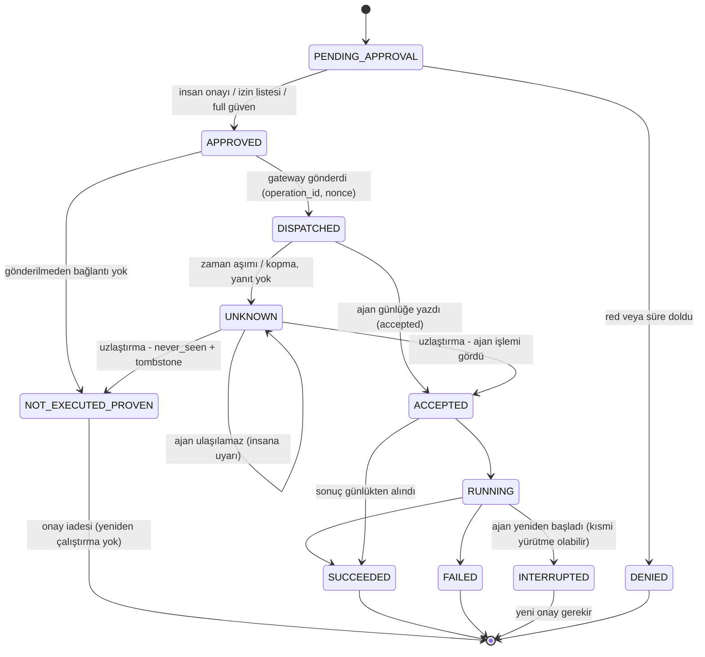

# WECOMMANDER V2 — Master Geliştirme Planı (User Mode + Agent Mode)

- **Sürüm:** v0.2 (son revizyon; PR #97 incelemesi sonrası)
- **Tarih:** 2026-11-07 · **Planlama başlangıcı:** 2026-11-09 (Pazartesi)
- **Doğrulanan kod:** `main` = `production` = `3b6734a` ("Discoverability for search engines and AI assistants (#95)")
- **Onaylanan mimari:** WECOMMANDER Desktop (Tauri 2 + Rust), iki bağımsız çalışma alanı. **User Mode** yerel öncelikli, Termius sınıfı SSH istemcisi; **Agent Mode** mevcut Rust Agent + Gateway + MCP sistemi. Mevcut web paneli korunur. Ana farklılaştırıcı: SSH ile bağlanılan sunucunun kontrollü biçimde Agent Mode'a yükseltilmesi.
- **Hesaplama sistemi:** veriler [`plans/data/wecommander_v2_work_packages.json`](./data/wecommander_v2_work_packages.json), hesaplama [`plans/tools/wecommander_v2_scheduler.py`](./tools/wecommander_v2_scheduler.py), testler `plans/tools/test_wecommander_v2_scheduler.py`. Bu belgedeki `GENERATED` bölümleri elle düzenlenmez; `python3 plans/tools/wecommander_v2_scheduler.py render --write` ile üretilir.
- **Takvimin niteliği:** Bu takvim kesin teslimat taahhüdü değildir; **doğrulanacak başlangıç tahminidir.** M1 sonunda zorunlu revizyon (R1) yapılır (§3.3).
- **Eşlik eden belgeler:** [`WECOMMANDER_V2_DEVELOPMENT_CALENDAR.md`](./WECOMMANDER_V2_DEVELOPMENT_CALENDAR.md) · [`WECOMMANDER_V2_DEPENDENCY_MATRIX.md`](./WECOMMANDER_V2_DEPENDENCY_MATRIX.md) · [`WECOMMANDER_V2_RELEASE_CRITERIA.md`](./WECOMMANDER_V2_RELEASE_CRITERIA.md) · [`WECOMMANDER_V2_SPRINT_01.md`](./WECOMMANDER_V2_SPRINT_01.md)

---

## 0. Bu planın mevcut planlarla ilişkisi

Bu belge **yeni bir plandır; mevcut planları silmez, değiştirmez, üzerine yazmaz.**

| Mevcut belge | İlişki |
|---|---|
| `plans/WEBRISING_COMMENDER_MASTER_PLAN.md` | Agent Mode v1.x'in kanonik planı olarak kalır. V2'deki B paketleri bu planın açık kapanış maddelerini (v1.0) **referans alır**, yeniden tanımlamaz. |
| `plans/V1_2_PLUS_ROADMAP.md` | v1.2 gözlem işleri B12 olarak V2 takvimine yerleştirilir. "Yönetim Merkezinden insan terminali" bölümündeki gateway akışı B05'e, istemci kısmı (Windows Terminal'de konsol programı) B06/B09'daki xterm.js masaüstü terminaline **devredilir**. Bu, o bölümün istemci tasarımından bir sapmadır; plan dosyası değiştirilmemiştir. |
| `plans/ADVANCED_DEVELOPMENT_PLAN_1.md` | AD1-09 (SSH/SFTP adaptörü) User Mode (A02/A09) ve B11 (bastion) ile karşılanır. AD1-14/15 (rollback, safe execution) V2 kapsamı dışında, kendi planında kalır. |
| `plans/FINAL_ACCEPTANCE_PLAN.md`, `PHASE_STATUS.md` | v1.0 kabul kapılarının kaynağı. B02 bunları kapatır. |
| PR [orhanbal/webrising-commender#96](https://github.com/orhanbal/webrising-commender/pull/96) (Draft, Termius analizi) | Mimari tartışmanın girdisidir. Oradaki F0–F6 yol haritasının yerini, onaylanan V2 mimarisi için bu plan alır. |

---

## 1. Güncel durum doğrulaması (2026-11-07)

### 1.1 Tamamlanmış — yeniden planlanmaz

| Alan | Kanıt |
|---|---|
| Rust Agent çekirdeği (fs, process, PTY, görevler, sistem bilgisi, ofis/PDF araçları) | `crates/agent/src/*.rs`, 284 test; CI `rust`, `rust-platforms` (windows/ubuntu/macos) |
| Gateway, relay, bölgesel relay, PostgreSQL şeması | `gateway/src/*.ts`, 37 tablo (`db.ts`), `gateway/test/*.mjs` |
| MCP (uzak + yerel stdio + OAuth) | `mcp.ts`, `oauth.ts`, `stdio_mcp.rs`, `mcp-client-acceptance.mjs` |
| Onay mekanizması (tek kullanımlık, HMAC, ajan doğrulamalı) | `approvals.ts`, `approval-requests.ts`, `crates/agent/src/approval.rs`, `ops.rs:115–120` |
| Komut izin listesi, güven seviyeleri `strict/standard/full` | `command-allowlist.ts`, `db.ts:287–291` |
| Çıktı maskeleme (dilim 1) | `crates/agent/src/redact.rs`; V1_2 roadmap "Durum 2026-11-05" |
| `health_snapshot`, `log_query` (Linux journal + dosya) | V1_2 roadmap durum notları; `log_ops.rs` |
| RBAC 4 rol, organizasyon, davet, API token, Paddle | `auth.ts:24`, `rbac-matrix-e2e.mjs`, `paddle.test.ts` |
| Windows Yönetim Merkezi (WinUI 3) ve Tauri tepsi | `center-windows/`, `tray/`; CI `center-windows`, `center-winui` |
| Kurulum betikleri (SHA-256 doğrulamalı), kaldırma betikleri | `install-scripts.ts`, `scripts/` |
| Ubuntu, Windows, macOS gerçek cihaz kabulleri (çekirdek) | `docs/UBUNTU_DEVICE_ACCEPTANCE.md`, `docs/MACOS_DEVICE_ACCEPTANCE.md` (Mac kabulü 2026-11-05) |
| Yedekleme ve CI restore tatbikatı | `backup-compose.sh`, `ci-postgres-restore.sh` |
| Discoverability (robots, sitemap, llms.txt, içerik sayfaları) | PR #95, production'da |

### 1.2 Eksik veya kısmen tamamlanmış — bu planda

| Madde | Durum | Paket |
|---|---|---|
| **AI `terminal_input` yetkilendirme boşluğu** | **Yeniden doğrulandı, açık.** `gateway/src/protocol.ts:343` `terminal_input` → `medium`; `mcp.ts:493` onay yalnız `high` için; ajan `ops.rs:115` yalnız `Risk::High` için token istiyor (`protocol.rs:346` aynı sınıflandırma). Terminal bir kez açıldıktan sonra AI istediğini yazabiliyor. | **B01** |
| Başarısız teslimatta tek kullanımlık onayın yanması ve çift yürütme riski | Açık. Gateway onayı göndermeden önce tüketiyor (`gateway/src/approvals.ts` `consumeApproval`, `consumed_at`); relay 30 sn sonra zaman aşımına düşüyor (`relay.ts:32`); ajan HMAC, cihaz, işlem ve süreyi doğruluyor ama **nonce'u kaydetmiyor** (`crates/agent/src/approval.rs` `verify`), yani süresi dolmamış bir token aynı ajana tekrar gelirse yeniden çalışır; ajanda kalıcı işlem kaydı yok | B03 |
| `health_snapshot` gürültüsü (bind-mount, veth, dockerd tekrarları) | Ubuntu'da gözlendi, açık | B12 |
| A4 canlı HTTPS/HSTS/TLS/WSS bağımsız doğrulama | Görev listesinde "in progress" | B02 |
| Production verisiyle restore tatbikatı | Açık (`PHASE_STATUS.md` dış kabul) | B02 |
| GitHub sıkılaştırması (etiket kuralı, `production` yalnız `main`), `v1.0` etiketi (A8) | Açık | B02 |
| WinUI "Urgent" bildirim senaryosunun sahibin cihazında doğrulanması | Açık | B02 |
| MFA / SSO | Kodda yok | B04 / B13 |
| Etkileşimli web terminali | Kodda yok (`Workspace.tsx:86` `<pre>`) | B05 + B06 |
| Servis/container gözlemi, Windows Event Log, macOS `log show`, sağlık geçmişi | `service_list`, `container_*` kodda yok; `log_ops.rs:437` "planned" | B12 |
| Açık PR'lar | [#29](https://github.com/orhanbal/webrising-commender/pull/29) (Draft, ConPTY testi), [#25](https://github.com/orhanbal/webrising-commender/pull/25) (1C/1D kabul kapıları), [#96](https://github.com/orhanbal/webrising-commender/pull/96) (Draft, analiz) | B02 (#29/#25 kararı) |
| User Mode | Hiç yok (yalnız `tray/` Tauri 2 iskeleti yeniden kullanılabilir) | A01–A30 |

---

## 2. Planlama varsayımları

1. **Efor birimi:** MH = deneyimli bir mühendisin tam zamanlı bir haftası; test, kod incelemesi ve dokümantasyon dahil. Aralıklar ±%40 belirsizlik taşır; takvim aralığın orta noktasıyla hesaplanmıştır.
2. **Etkin kapasite:** geliştirici başına haftada **0,8 MH** (destek, toplantı, inceleme, izin ve resmî tatiller bu kayba dahil).
3. **Koordinasyon maliyeti:** 2 geliştiricide efor ×1,10; 4 geliştiricide ×1,25.
4. **Yeni geliştiriciler** 1 hafta gecikmeyle (işe alışma) başlar.
5. **AI destekli geliştirme verimlilik kazancı takvime yansıtılmamıştır** (§7).
6. Gerçek cihaz kabulleri sahibin donanımıyla yapılır: Windows PC, Ubuntu sunucu, Mac (mevcut). Mobil cihazlar M7 için gerekir.
7. Production'a çıkış yalnız `promote-production.yml` + sahibin `production` onayı ile.
8. Kullanıcının kendi AI sağlayıcısını kullanma kararı korunur; hiçbir paket zorunlu bir AI sağlayıcısı getirmez.
9. Paket süresi = ⌈efor × hız katsayısı ÷ kapasite × koordinasyon⌉ hafta. Hız katsayısı başlangıçta 1,0'dır; gerçekleşen eforlar `plans/data/wecommander_v2_actuals.json` dosyasına işlendikçe hesaplanır.
10. Bütün parametreler (kapasite, koordinasyon, stabilizasyon süreleri, tampon, işe alışma) veri dosyasındadır ve değiştirildiğinde takvim aynı araçla yeniden üretilir.

---

## 3. Paket özeti, kilometre taşları ve doğrulama kapıları

### 3.1 Efor özeti

<!-- GENERATED:BEGIN effort -->
| Plan | Paket | Düşük | Orta nokta (takvim) | Yüksek |
|---|---|---|---|---|
| A — User Mode | 30 | 87 MH | 104 MH | 121 MH |
| B — Agent Mode | 13 | 32 MH | 37 MH | 42 MH |
| **Toplam** | 43 | 119 MH | 141 MH | 163 MH |

Önceki sürüm (v0.1) toplamı: 136,25 MH → bu sürüm: 141 MH (fark 4,75 MH). Hız katsayısı (actuals): 1.
<!-- GENERATED:END effort -->

### 3.2 Paket listesi (43 paket)

<!-- GENERATED:BEGIN packages -->
| Kod | Ad | Plan | Kilometre taşı | Öncelik | Efor (MH) | Ön koşullar |
|---|---|---|---|---|---|---|
| B01 | AI terminal_input yetkilendirme düzeltmesi | B | M0 | P0 | 1–1,5 | — |
| B02 | Production kabul kapanışı (v1.0 / A4 / A7 / A8) | B | M0 | P0 | 1,5–2 | B01, B03 |
| B03 | Onaylı işlem durum makinesi ve teslimat güvencesi | B | M0 | P0 | 3–4 | B01 |
| B04 | MFA (TOTP + WebAuthn) ve yeniden doğrulama | B | M6 | P1 | 3–4 | B01 |
| B05 | İnsan terminali akışı (gateway + ajan) | B | M6 | P1 | 2–3 | B04 |
| B06 | Web panelinde gerçek terminal | B | M6 | P1 | 1,5–2 | B05, A03 |
| B07 | Regresyon test paketi ve sürüm adayı kontrol listesi | B | M6 | P1 | 2 | B02 |
| B08 | Masaüstü oturum açma ve SSH eşleştirme uçları | B | M4 | P1 | 1,5–2 | B04 |
| B09 | Masaüstünde Agent çalışma alanı | B | M4 | P1 | 3–4 | B08, A01, A03 |
| B10 | Uçtan uca şifreli senkronizasyon sunucusu | B | M5 | P2 | 2–3 | B04 |
| B11 | Bastion SSH (Agent Mode) | B | M7 | P3 | 6–8 | A02, B05 |
| B12 | v1.2 gözlem işleri ve health_snapshot gürültüsü | B | M6 | P2 | 2,5–3,5 | B03 |
| B13 | OIDC SSO | B | M7 | P3 | 3 | B04 |
| A01 | Desktop uygulama iskeleti ve depo yapısı (G1) | A | M1 | P0 | 2,5–3,5 | — |
| A02 | SSH çekirdeği wc-ssh-core (G2) | A | M1 | P0 | 3,5–5,5 | — |
| A03 | Terminal arayüz paketi (G3) | A | M1 | P0 | 2,5–3,5 | — |
| A04 | Paketleme, dağıtım ve otomatik güncelleme | A | M2 | P0 | 2–3 | A01 |
| A05 | Yerel kasa (wc-vault) ve anahtar yönetimi | A | M2 | P0 | 3–4 | A01 |
| A06 | Host key doğrulaması ve known_hosts | A | M2 | P0 | 1,5–2 | A02, A05 |
| A07 | Hosts, Groups, Tags, profiller, ssh_config | A | M2 | P0 | 2–3 | A05 |
| A08 | Terminal sekmeleri ve oturum yönetimi | A | M2 | P0 | 2–3 | A01, A02, A03 |
| A09 | SFTP dosya yöneticisi | A | M2 | P0 | 4–5 | A01, A02 |
| A10 | Jump Host ve Local Port Forwarding | A | M2 | P0 | 2–3 | A02, A07 |
| A11 | MVP güvenlik incelemesi, gerçek cihaz kabulü ve kullanıcı belgeleri | A | M2 | P0 | 2–3 | A04, A06, A07, A08, A09, A10 |
| A12 | Split View ve güvenli Broadcast | A | M3 | P1 | 2–3 | A08 |
| A13 | Workspaces ve oturum geri yükleme | A | M3 | P1 | 2 | A12, A07 |
| A14 | Snippets, komut geçmişi, autocomplete | A | M3 | P1 | 2–3 | A08, A05 |
| A15 | Remote Forward, SOCKS ve proxy | A | M3 | P1 | 2–3 | A10 |
| A16 | Agent Forwarding ve SSH sertifikaları | A | M3 | P1 | 3–4 | A05, A10 |
| A17 | FIDO2 / donanım anahtarı | A | M5 | P2 | 3–5 | A16 |
| A18 | SCP | A | M5 | P2 | 1 | A09 |
| A19 | Tema, font, kısayollar, terminal arama, ayarlar | A | U1 | P1 | 1,5–2 | A03 |
| A20 | Uçtan uca şifreli kişisel senkronizasyon (istemci) | A | M5 | P1 | 4–5 | A05, B10 |
| A21 | Bağımsız güvenlik ve kriptografi incelemesi | A | M5 | P1 | 1,5 | A20, A16, A15 |
| A22 | Ekip özellikleri (kasa, hostlar, çalışma alanları, RBAC, denetim) | A | M5 | P1 | 6–8 | A20, A21 |
| A23 | SSH'tan Agent Mode'a yükseltme | A | M4 | P1 | 2–3 | B08, A08 |
| A24 | Kontrollü AI asistanı (kullanıcının kendi anahtarı) | A | M6 | P1 | 3–4 | A25, A08, B01 |
| A25 | Komut risk değerlendirmesi | A | M6 | P1 | 2–3 | A12, A14 |
| A26 | Gelişmiş operasyon araçları | A | M6 | P2 | 3–4 | A23 |
| A27 | Ortak terminal oturumu (Multiplayer, tek yazar) | A | M7 | P2 | 4–6 | A22 |
| A28 | Android | A | M7 | P2 | 8–10 | S-STABLE |
| A29 | iOS | A | M7 | P2 | 6–10 | A28 |
| A30 | Kurumsal politikalar | A | M7 | P3 | 4–5 | A22, B13 |
<!-- GENERATED:END packages -->

### 3.3 Kilometre taşları

Yeni kilometre taşı **U1 — User Mode 1.0 Stable**, temel SSH uygulamasının kararlı sürümünü V2 Stable'dan (M6) ayırır. U1; ekip kasası, senkronizasyon, mobil ve AI özelliklerini beklemez. Tarihi gerçek bağımlılıklardan hesaplanır: MVP paketleri (A04–A11), A19 (temel terminal ayarları), MVP stabilizasyonu ve 4 haftalık genel beta/RC/kabul dönemi (`S-U1`).

<!-- GENERATED:BEGIN milestones-default -->
| Kilometre taşı | Plan tarihi (S2) | Hedef sürüm tarihi (S2, tampon dahil) | Kapsam |
|---|---|---|---|
| **M0** Agent Mode güvenlik ve production kapanışı | 2027-01-15 | 2027-01-29 | B01, B02, B03 |
| **M1** Çalışan User Mode SSH prototipi | 2027-03-12 | 2027-04-02 | A01, A02, A03 |
| **M2** User Mode kullanılabilir MVP | 2027-08-06 | 2027-09-17 | A04, A05, A06, A07, A08, A09, A10, A11 + S-MVP |
| **U1** User Mode 1.0 Stable | 2027-09-03 | 2027-10-22 | A19 + S-U1 |
| **M3** Genişletilmiş özellik Beta'sı (User Mode 1.x, 3 işletim sistemi) | 2028-01-14 | 2028-03-24 | A12, A13, A14, A15, A16 + S-BETA |
| **M4** Agent Mode entegrasyonu | 2028-03-17 | 2028-06-02 | B08, B09, A23 + S-INT |
| **M5** Termius masaüstü özellik eşitliği | 2028-09-15 | 2028-12-29 | A17, A18, A20, A21, A22, B10 + S-PAR |
| **M6** WECOMMANDER V2 Stable | 2028-10-13 | 2029-02-02 | A24, A25, A26, B04, B05, B06, B07, B12 + S-STABLE |
| **M7** Mobil ve kurumsal genişleme | 2029-04-20 | 2029-09-07 | A27, A28, A29, A30, B11, B13 + S-M7 |
<!-- GENERATED:END milestones-default -->

### 3.4 Teknik doğrulama kapıları ve zorunlu takvim revizyonu (R1)

İlk takvim bir tahmindir. En büyük teknik belirsizlikler (russh uyumluluğu, `russh-sftp` olgunluğu, Windows OpenSSH ve macOS SSH uyumluluğu, WebKitGTK'de xterm.js performansı, Tauri paketleme ve güncelleme, işletim sistemleri arasında güvenli anahtar saklama) A01–A03 içinde ölçülür.

<!-- GENERATED:BEGIN gates -->
| Kapı | Ne zaman | Ad | Kontroller | Başarısızlıkta |
|---|---|---|---|---|
| G1 | A01 bitince (S2: 2026-12-18) | Tauri paketleme/güncelleme ve anahtar deposu doğrulaması | Windows, macOS ve Linux'ta imzalı güncelleme manifestiyle N → N+1 güncelleme turu Windows DPAPI/Credential Manager, macOS Keychain, Linux Secret Service ile keyring duman testi; Secret Service olmayan Linux'ta ana parola yolunun çalışması Kurulum boyutu ve ilk açılış süresi ölçümü | A04 ve A05 tahminleri yeniden hesaplanır; gerekirse Linux için ana parola zorunlu varsayılan olur |
| G2 | A02 bitince (S2: 2027-02-05) | russh uyumluluk matrisi ve SFTP olgunluğu | Ubuntu OpenSSH 9.x, eski OpenSSH 7.x, Windows OpenSSH Server, macOS sshd ile parola, anahtar, keyboard-interactive ve harici ajan Algoritma matrisi (kex, host key, şifre, MAC) ve Terrapin önlemleri russh-sftp ile 1 GB yükleme/indirme, devam, 10.000 dosyalı dizin listeleme (2 günlük teknik deneme) FIDO2 (sk-*) desteğinin russh'ta var olup olmadığının belirlenmesi | russh-sftp yetersizse A09'a +2 MH (SFTP v3 katmanı); FIDO2 yerleşik değilse A17 OpenSSH uyumluluk motoruyla başlar (tahmin değişmez) |
| G3 | A03 bitince (S2: 2027-03-12) | xterm.js WebView performansı | WebView2, WKWebView ve WebKitGTK'de 10 MB çıktı akışında arayüzün donmaması WebGL çizicinin kullanılamadığı yerde canvas/DOM'a düşme vim, htop, Türkçe IME, kopyala/yapıştır | Linux için ek optimizasyon işi A08'e +1 MH; Linux U1 kapsamında 'beta' etiketiyle kalabilir |
| R1 | M1 bitince (S2: 2027-03-12) | Zorunlu takvim revizyonu | A01–A03 gerçekleşen eforları actuals dosyasına işlenir Hız katsayısı hesaplanır ve kalan paketlere uygulanır G1–G3 sonuçlarına göre yeniden tahminler girilir Takvim aynı araçla yeniden üretilir ve belgeler güncellenir (ayrı PR) | Hız katsayısı 1,3'ün üstündeyse sahip kapsam veya kaynak kararı verir |
<!-- GENERATED:END gates -->

**Revizyon prosedürü (R1, M1 bitince zorunlu):**
1. A01, A02 ve A03'ün gerçekleşen eforu (mühendis-haftası, iş günlerinden hesaplanır) ve başlangıç/bitiş tarihleri `plans/data/wecommander_v2_actuals.json` dosyasındaki `completed` alanına işlenir.
2. Araç hız katsayısını hesaplar: gerçekleşen toplam ÷ planlanan orta nokta toplamı.
3. Katsayı yeniden tahmin girilmemiş kalan bütün paketlere uygulanır. G1–G3 sonuçlarına göre bilinen değişiklikler (ör. SFTP katmanı) `reestimates` alanına mühendis-haftası olarak yazılır; bunlara katsayı ayrıca uygulanmaz.
4. `render --write` ile dört belge yeniden üretilir; `check` ve testler yeşil olmalıdır.
5. Revizyon ayrı bir PR olarak açılır; PR'da eski ve yeni kilometre taşı tarihleri karşılaştırılır.
6. Hız katsayısı 1,3'ün üstündeyse sahip kapsam (ör. M5 kapsamını bölmek) veya kaynak (S2 → S4) kararı verir. 0,8'in altındaysa kazanç tampon olarak tutulur, tarih öne çekilmez.
7. Aynı prosedür M2 ve U1 sonunda da önerilir (zorunlu değil).

## 4. PLAN B — AGENT MODE

### B01 · AI `terminal_input` yetkilendirme düzeltmesi
- **Teknik açıklama:** AI kaynaklı (MCP, OAuth, API token) her `terminal_input` ya (a) girişin içeriğine bağlı tek kullanımlık onay token'ı (`sessionId + sha256(dataBase64) + exp + nonce`) ya da (b) insanın o oturuma verdiği süreli "AI yazabilir" izni ister. `full` güven seviyesi mevcut mantıkla çalışır ve `trusted_full` olarak denetlenir. İnsan (tarayıcı/masaüstü) kapsamındaki oturumlar etkilenmez. **Uygulama noktası ajandır:** gateway atlatılsa da ajan token'sız AI girişini reddeder.
- **Dosyalar:** `gateway/src/protocol.ts` (`actionRisk`), `gateway/src/mcp.ts` (onay akışı, araç açıklaması), `gateway/src/security.ts` (onay claim'i), `crates/agent/src/protocol.rs` (`risk()`), `crates/agent/src/ops.rs`, `crates/agent/src/approval.rs`, `crates/agent/src/terminal.rs` (oturum başına AI yazma izni), `gateway/src/dc-compat.ts`, `plans/MCP_TOOL_CONTRACT_MATRIX_20261024.md` (yalnız yeni satır; mevcut içerik değişmez).
- **Teknoloji:** Mevcut HMAC onay şeması.
- **Yeniden kullanılan:** `issueApproval`, `consumeApproval`, `approval::verify`, onay kuyruğu UI'ı, Yönetim Merkezi bildirimleri.
- **Ön koşul:** Yok. **Bağımlı işler:** B02, B04, B05, A24. **Paralel:** B03, A01, A02.
- **Öncelik:** P0 · **Efor:** 1–1,5 MH
- **Güvenlik:** Token girişin hash'ine bağlı; nonce tekrarı reddedilir; denetimde giriş maskelenmiş metin olarak tutulur; `terminal_input` boyut sınırı (`MAX_TERMINAL_INPUT_BASE64_BYTES`) korunur.
- **Testler:** Token'sız AI girişi → onay isteği, giriş çalışmaz. Başka veri için token → red. Nonce tekrarı → red. Süresi geçmiş token → red. `strict` → her giriş onaylı. `full` (süresi dolmamış) → izinli ve `trusted_full`. `human:*` kapsamı etkilenmez. Gateway'i atlayan sahte istek → ajan reddeder (Rust birim testi). DC uyumluluk yolu aynı kuraldan geçer.
- **Kabul:** Yukarıdaki testler CI'da; `mcp-client-acceptance.mjs` geçer; Windows ve Ubuntu'da Claude ile gerçek kabul (onay → giriş çalışır, onaysız → çalışmaz).
- **Tamamlanma kanıtı:** Merge edilmiş PR, yeşil CI run linki, production promote run'ı, `docs/` altında kabul notu.

### B02 · Production kabul kapanışı (v1.0 / A4 / A7 / A8)
- **Teknik açıklama:** A4 canlı TLS/HSTS/WSS bağımsız doğrulama raporu; production yedeğiyle ayrı ortamda restore tatbikatı ve süre/bütünlük kanıtı; GitHub sıkılaştırması (etiket koruması, `production` ortamı yalnız `main`); PR #29 ve #25 için karar; WinUI Urgent bildiriminin sahibin cihazında doğrulanması; `v1.0` etiketi.
- **Dosyalar:** `plans/BACKUP_RECOVERY_RUNBOOK.md` (kanıt eki), `docs/OPERATIONS.md`, `docs/PRODUCTION_ACCEPTANCE.md`, `.github/` ayarları (UI üzerinden), `gateway/test/tls-smoke.mjs`.
- **Teknoloji:** Mevcut betikler, `openssl s_client`, `testssl.sh` benzeri araç (bağımsız doğrulama).
- **Yeniden kullanılan:** `restore-compose.sh`, `test-postgres-restore.sh`, `promote-production.yml`.
- **Ön koşul:** B01 (v1.0 bu açıkla etiketlenmez), B03. **Bağımlı:** B07, M0. **Paralel:** A01–A03.
- **Öncelik:** P0 · **Efor:** 1,5–2 MH (+ sahibin donanım/onay zamanı)
- **Güvenlik:** Restore ayrı veritabanına yapılır; production sırları tatbikat ortamına kopyalanmaz.
- **Testler:** Restore sonrası satır sayıları, son denetim kaydı, `migration-idempotence.mjs`; TLS raporu (protokol, şifre takımları, HSTS, sertifika zinciri, WSS kimlik doğrulama).
- **Kabul:** `PHASE_STATUS.md`'deki dış kabul listesinin tamamı kanıtlı; `v1.0` etiketi production SHA'sında.
- **Tamamlanma kanıtı:** Restore raporu, TLS raporu, etiket, ayar ekran görüntüleri.

### B03 · Onaylı işlem durum makinesi ve teslimat güvencesi
- **Teknik açıklama:** v0.1'deki "işlem ajana ulaşmadıysa onayı iade et" yaklaşımı **değiştirildi.** Dağıtık sistemde bağlantı koptuğunda işlemin çalışıp çalışmadığı gateway tarafından kesin bilinemez. **Temel kural:** bir komutun çalışmadığı kesin olarak kanıtlanamıyorsa otomatik yeniden yürütme ve otomatik onay iadesi yapılmaz.

  Tasarım beş parçadan oluşur:
  1. **İşlem kimliği ve kalıcı işlem tablosu (gateway):** Onaylı her yüksek riskli işlem için `operation_id` (UUIDv7) ve PostgreSQL'de `operations` tablosu: durum, cihaz, işlem özeti, onay nonce'u, istemci idempotency anahtarı, zaman damgaları. Gateway yeniden başlasa da durum kaybolmaz.
  2. **Kalıcı işlem günlüğü (ajan):** Ajan, işlemi çalıştırmadan **önce** `operation_id` ve onay nonce'unu diske yazar (fsync). Aynı nonce veya aynı `operation_id` ikinci kez gelirse çalıştırmaz, kayıtlı durumu döndürür. Bu, bugün eksik olan ajan tarafı tekrar oynatma korumasını da kapatır.
  3. **Teslimat doğrulaması:** Ajan, günlüğe yazdıktan sonra `accepted(operation_id)` gönderir; ardından sonuç gelir. Sonuç kaybolursa gateway sonucu günlükten yeniden ister.
  4. **Durum sorgulama ve uzlaştırma:** Bağlantı koptuğunda ya da gateway yeniden başladığında, ajan yeniden bağlanınca gateway `operation_status(operation_id)` sorar. Ajan işlemi hiç görmediyse `operation_id` için **kalıcı bir red kaydı (tombstone)** yazar ve `never_seen` döner. Böylece işlemin hiçbir zaman çalışmayacağı kanıtlanmış olur; geç gelen bir kopya da reddedilir.
  5. **İdempotency:** İstemci aynı isteği (aynı idempotency anahtarı veya aynı MCP çağrı kimliği + parametre özeti) tekrar gönderirse yeni işlem açılmaz; mevcut işlemin durumu döner.

  **Onay iadesi** yalnız `NOT_EXECUTED_PROVEN` durumunda yapılır. Bu durumda bile yeniden yürütme otomatik değildir; istemci açıkça yeniden çağırmalıdır. `UNKNOWN` durumunda insana "çalışmış olabilir" uyarısı, kanıtlar (son bilinen durum, ajan günlüğü yanıtı) ve yeni onay gerektiren bir yeniden deneme seçeneği gösterilir.

- **Dosyalar:** `gateway/src/approvals.ts`, `approval-requests.ts`, `relay.ts`, `relay-cancellation.ts`, `mcp.ts`, `db.ts` (yeni `operations` tablosu), `crates/agent/src/approval.rs`, `ops.rs`, `protocol.rs` (`accepted`, `operation_status`), yeni `crates/agent/src/operation_journal.rs`, `task_manager.rs` (uzun görevler aynı günlüğü kullanır).
- **Teknoloji:** PostgreSQL işlem tablosu; ajanda ekleme yapılan (append-only), sağlama toplamlı günlük dosyası (`terminal_history.rs` biçim deneyimi); UUIDv7.
- **Yeniden kullanılan:** `consumeApproval`, `approval::verify`, relay iptal altyapısı, onay kuyruğu UI'ı.
- **Ön koşul:** B01 (aynı onay yüzeyi; sırayla yapılır). **Bağımlı:** B02 (v1.0 bu düzeltme olmadan etiketlenmez), B12. **Paralel:** A01, A02, A03.
- **Öncelik:** P0 · **Efor:** 3–4 MH (v0.1'de 1–1,5 MH; health_snapshot B12'ye taşındı)
- **Güvenlik:** Nonce ajan tarafında da tek kullanımlık; günlükte komut metni maskelenmiş; günlük bozulursa ajan güvenli yönde başarısız olur (yeni yüksek riskli işlem kabul etmez, durum `UNKNOWN`); tombstone kalıcıdır.
- **Test senaryoları (her biri ayrı otomatik test, gerçek ajanla):**

| # | Senaryo | Beklenen davranış |
|---|---|---|
| 1 | İşlem gönderilmeden bağlantı kopar | `NOT_EXECUTED_PROVEN`; onay iadesi; komut çalışmaz; istemciye "çalışmadı, tekrar deneyebilirsiniz" |
| 2 | İşlem ajana ulaştıktan sonra (günlüğe yazıldı) bağlantı kopar | Uzlaştırmada `ACCEPTED/RUNNING`; onay iadesi yok; sonuç yeniden bağlanınca alınır |
| 3 | İşlem çalışırken bağlantı kopar | `RUNNING` korunur; görev sürer; sonuç sonra alınır; yeniden yürütme yok |
| 4 | İşlem tamamlandıktan sonra yanıt kaybolur | Uzlaştırmada `SUCCEEDED` ve sonuç günlükten; ikinci yürütme yok |
| 5 | Aynı istek yeniden gönderilir (aynı idempotency anahtarı) | Yeni işlem açılmaz; mevcut durum döner |
| 6 | Gateway yeniden başlar (DISPATCHED/ACCEPTED işlemler varken) | `operations` tablosundan durum yüklenir; ajan bağlanınca uzlaştırma; çift yürütme yok |
| 7 | Ajan yeniden başlar (RUNNING işlem varken) | Günlükte bitmemiş kayıt `INTERRUPTED`; "kısmen çalışmış olabilir" uyarısı; yeni onay gerekir |
| 8 | Onay token'ı tekrar kullanılır (gateway'i atlayan doğrudan kopya dahil) | Gateway `consumed_at` ile, ajan günlükteki nonce ile reddeder |
| ek | Ajan ulaşılamazken uzlaştırma | `UNKNOWN` kalır; otomatik iade yok; insana kanıtlı uyarı |
| ek | Günlük dosyası bozulur | Yeni yüksek riskli işlem reddedilir; `policy_info` bozulmayı raporlar |

- **Kabul:** Yukarıdaki testler CI'da (ağ kesintisi ve süreç sonlandırma ile hata enjeksiyonu); Windows ve Ubuntu'da gerçek ağ kesintisiyle elle kabul; `mcp-client-acceptance.mjs` geçer; hata metinleri MCP istemcisinde anlaşılır.
- **Tamamlanma kanıtı:** Durum makinesi tasarım notu (`docs/OPERATION_STATE_MACHINE.md`), merge edilmiş PR'lar, CI run linki, kabul notu.

### B04 · MFA (TOTP + WebAuthn/passkey) ve kritik işlemlerde yeniden doğrulama
- **Teknik açıklama:** Kullanıcı başına TOTP ve WebAuthn; hash'li kurtarma kodları; `browser_sessions.mfa_verified_at`; `requireRecentMfa(maxAge)` ara katmanı: terminal açma, onay verme (yapılandırılabilir), `full` güven, API token oluşturma, rol değişimi. Organizasyon politikası "MFA zorunlu". Yönetim Merkezi ve Desktop, yeniden doğrulamayı tarayıcıya yönlendirir.
- **Dosyalar:** `gateway/src/browser-auth.ts`, `auth.ts`, `db.ts` (yeni tablolar), `rate-limit.ts`, `gateway/ui/src/pages/Auth.tsx` ve hesap ayarları, `center-link.ts`.
- **Teknoloji:** `@simplewebauthn/server` (MIT); TOTP için `node:crypto`.
- **Ön koşul:** B01. **Bağımlı:** B05, B08, B10, B13. **Paralel:** A01–A05.
- **Öncelik:** P1 · **Efor:** 3–4 MH
- **Güvenlik:** TOTP sırrı şifreli kolon; tekrar oynatma engeli; kurtarma kodu kaba kuvvet sınırı; MFA etkinleşince diğer oturumların sonlandırılması.
- **Testler:** ±1 zaman penceresi, tekrar reddi, `403 mfa_required`, 10 dakikadan sonra yeniden isteme, Playwright sanal doğrulayıcı ile WebAuthn, genişletilmiş RBAC matrisi.
- **Kabul:** Sahibin hesabında TOTP + passkey; Windows Yönetim Merkezi'nden onay yeniden doğrulamayla çalışır.
- **Tamamlanma kanıtı:** PR, CI, kabul notu.

### B05 · İnsan terminali akışı (gateway + ajan)
- **Teknik açıklama:** Tek kullanımlık, 60 saniyelik terminal bileti; `/api/terminal/stream` WebSocket; ajandan PTY çıktısının push edilmesi (bugünkü yoklamalı `read` geriye uyumlu kalır); `human:<userId>` kapsamı; cihazda `humanTerminal` yeteneği (varsayılan kapalı); boşta 30 dk kapanma; 8 saat üst sınır; denetim (başlangıç/bitiş, süre, bayt).
- **Dosyalar:** `gateway/src/index.ts`, `relay.ts`, `relay-stream.ts`, `security.ts`, `crates/agent/src/terminal.rs`, `protocol.rs`, `terminal_history.rs`.
- **Yeniden kullanılan:** `TerminalManager`, kapsam kontrolleri, relay akış deseni.
- **Ön koşul:** B04. **Bağımlı:** B06, B09, B11. **Paralel:** A06–A10.
- **Öncelik:** P1 · **Efor:** 2–3 MH
- **Güvenlik:** Bilet tek kullanımlık; AI token'ı `human:*` oturumlarını listeleyemez; organizasyon başına eşzamanlı terminal kotası.
- **Testler:** Bilet ömrü ve tekrar; kapsam ayrımı; ağ kopması sonrası geçmişin geri gelmesi; kota.
- **Kabul:** Windows (ConPTY) ve Ubuntu'da akış; gecikme ölçümü.
- **Tamamlanma kanıtı:** PR, CI, gecikme raporu.

### B06 · Web panelinde gerçek terminal
- **Teknik açıklama:** `packages/terminal-ui` (A03) web panelinde; sekmeler; yeniden bağlanınca `read_page` ile geçmiş doldurma; kopyala/yapıştır; Türkçe giriş; CSP sıkılaştırması.
- **Dosyalar:** `gateway/ui/src/pages/Workspace.tsx`, yeni `Terminal.tsx`, `gateway/src/index.ts` (CSP satırı 379).
- **Ön koşul:** B05, A03. **Bağımlı:** B09. **Paralel:** A12–A15.
- **Öncelik:** P1 · **Efor:** 1,5–2 MH
- **Güvenlik:** `script-src` sıkılaştırması; xterm link eklentisi kapalı; giriş içeriği loglanmaz.
- **Testler:** Playwright + gerçek ajan: `vim`, `htop`, boyutlandırma, yeniden bağlanma; viewer rolü, MFA'sız, başka organizasyon negatifleri.
- **Kabul:** p95 tuş→yankı < 150 ms (aynı bölge); Windows ve Ubuntu'da.
- **Tamamlanma kanıtı:** PR, CI (`modern-ui-visual.mjs` genişletmesi), kabul notu.

### B07 · Regresyon test paketi ve sürüm adayı kontrol listesi
- **Teknik açıklama:** Mevcut özelliklerin her sürüm adayında çalıştırılan otomatik + manuel regresyonu. Otomatik: `agent-e2e`, `rbac-matrix-e2e`, `mcp-client-acceptance`, `local-stdio-e2e`, `relay-e2e`. Manuel: 3 işletim sisteminde cihaz kontrol listesi (`docs/RELEASE_POLICY.md`'ye ek değil, yeni `docs/REGRESSION_CHECKLIST.md`). Sürüm notu şablonu.
- **Dosyalar:** `.github/workflows/ci.yml` (yeni toplu iş), `docs/REGRESSION_CHECKLIST.md`.
- **Ön koşul:** B02. **Bağımlı:** her kilometre taşı. **Paralel:** her şey.
- **Öncelik:** P1 · **Efor:** 2 MH
- **Testler:** Kendi kendine doğrulama: bilerek bozulan bir özelliği yakalamalı.
- **Kabul:** M2'den itibaren her yayın bu listeyle onaylanır.
- **Tamamlanma kanıtı:** Doldurulmuş ilk kontrol listesi.

### B08 · Masaüstü oturum açma ve SSH üzerinden eşleştirme uçları
- **Teknik açıklama:** Desktop'ın Agent Mode'a `center-link` ile oturum açması (yeniden doğrulamalı); "SSH üzerinden ajan kur" için masaüstü oturumuna bağlı, tek kullanımlık, kısa ömürlü eşleştirme kodu; kurulum betiğinin hash'i ve sürümü API'den.
- **Dosyalar:** `gateway/src/center-link.ts`, `device-link.ts`, `install-scripts.ts`, `db.ts`.
- **Ön koşul:** B04. **Bağımlı:** B09, A23. **Paralel:** A12–A16.
- **Öncelik:** P1 · **Efor:** 1,5–2 MH
- **Güvenlik:** Kod tek kullanımlık, 10 dakika, organizasyona bağlı; yeniden doğrulama zorunlu; `wmc_` token kapsamı (`centerMayAccess`) genişletilmez, yeni ayrı kapsam.
- **Testler:** Kod tekrarı, süresi geçmiş kod, başka organizasyon, yetkisiz rol.
- **Kabul:** Masaüstünden alınan kodla Ubuntu'ya kurulan ajan doğru organizasyonda görünür.
- **Tamamlanma kanıtı:** PR, CI, kabul notu.

### B09 · Masaüstünde Agent çalışma alanı (Yönetim Merkezi işlevleri)
- **Teknik açıklama:** Desktop'ın Agent sekmesi: cihazlar, bekleyen onaylar (Onayla/Reddet), otonom mod, bildirimler (Windows'ta Urgent senaryosu korunur), insan terminali (B05/B06 akışı). WinUI Yönetim Merkezi bu sekme eşdeğerliğe ulaşana kadar korunur; ardından kurulum betiği Desktop'a yönlendirir.
- **Dosyalar:** `desktop/` (A01), `center-windows/` (yalnız kullanımdan kaldırma notu), `scripts/install-center-windows-online.ps1`.
- **Teknoloji:** Tauri 2, `tauri-plugin-notification`, platform anahtar deposu.
- **Yeniden kullanılan:** `tray/src/main.rs` mantığı, WinUI'deki DPAPI token deseni, center-link API'leri.
- **Ön koşul:** B08, A01, A03. **Bağımlı:** A23 (aynı çalışma alanı), M4. **Paralel:** A17, A20.
- **Öncelik:** P1 · **Efor:** 3–4 MH
- **Güvenlik:** Token yalnız OS anahtar deposunda; bildirimde komut içeriği yok.
- **Testler:** WinUI ile aynı senaryolar (onay paneli otomatik açılır, Rahatsız Etmeyin'i aşan bildirim, oturum aç/kapat).
- **Kabul:** Windows, macOS, Linux'ta onay bildirimi ve onay verme.
- **Tamamlanma kanıtı:** PR, 3 işletim sisteminde kabul notu.

### B10 · Uçtan uca şifreli senkronizasyon sunucusu (Gateway)
- **Teknik açıklama:** Gateway'de yalnız şifreli kayıt tutan senkronizasyon uçları: kayıt kimliği, sürüm vektörü, şifreli içerik, silme izi (tombstone); kullanıcı/ekip kasası anahtar zarfları; kota. Self-hosted ve SaaS'ta aynı kod.
- **Dosyalar:** `gateway/src/sync.ts` (yeni), `db.ts`, `index.ts`, `rate-limit.ts`.
- **Ön koşul:** B04. **Bağımlı:** A20, A22. **Paralel:** A17, B09.
- **Öncelik:** P2 · **Efor:** 2–3 MH
- **Güvenlik:** Sunucu düz metin görmez; içerik boyutu ve kayıt sayısı kotası; loglarda içerik yok.
- **Testler:** Çakışma, tombstone, kota, organizasyon izolasyonu, sahte istemciyle uyumluluk.
- **Kabul:** Veritabanı dökümünde host adı/IP düz metin olarak bulunmaz (otomatik tarama).
- **Tamamlanma kanıtı:** PR, CI, tarama çıktısı.

### B11 · Bastion SSH (Agent Mode'dan ajansız hedefler)
- **Teknik açıklama:** Ajan, `wc-ssh-core` ile izin listesindeki hedeflere SSH yapar; hedef listesi (host/CIDR+port), host key sabitleme, SSRF korumaları (metadata, link-local, loopback; DNS sonrası IP yeniden kontrolü); AI yalnız exec; `-L/-R/-D`, agent forwarding, X11 kapalı.
- **Dosyalar:** `crates/agent/src/ssh_target.rs` (yeni), `policy.rs`, `protocol.rs`, `gateway/src/mcp.ts`, `db.ts`.
- **Ön koşul:** A02, B05. **Bağımlı:** M7. **Paralel:** A27–A30.
- **Öncelik:** P3 · **Efor:** 6–8 MH
- **Güvenlik:** Onay token'ı hedefe bağlı; gateway'de private key yok.
- **Testler:** Konteynerde OpenSSH; host key değişimi; SSRF negatifleri; DNS rebinding.
- **Kabul:** Ubuntu bastion → ikinci VM; gateway DB'sinde anahtar yok.
- **Tamamlanma kanıtı:** PR, CI, kabul notu.

### B12 · v1.2 gözlem işleri ve `health_snapshot` gürültüsü
- **Teknik açıklama:** `health_snapshot`: bind-mount disk tekilleştirme, `veth*`/`br-*`/`docker0` gruplama, aynı adlı süreçlerin birleştirilmesi (v0.1'de B03'teydi). Ayrıca `service_list/service_status` (systemd, SCM, launchd), `container_list/inspect/logs` (salt okuma), Windows Event Log ve macOS `log show`, gateway'de 24 saatlik sağlık geçmişi ve panoda sağlık kartı (V1_2 roadmap madde 3–6).
- **Dosyalar:** `crates/agent/src/system_ops.rs`, `log_ops.rs`, yeni `inventory.rs`, `gateway/src/mcp.ts`, `local-tools.ts`, UI `Devices.tsx`.
- **Ön koşul:** B03. **Bağımlı:** A26. **Paralel:** A12–A16.
- **Öncelik:** P2 · **Efor:** 2,5–3,5 MH
- **Güvenlik:** Maskeleme; docker soketine yalnız okuma; yetki yoksa `unavailable`.
- **Testler:** V1_2 roadmap'teki kabul listesi.
- **Kabul:** Ubuntu (Coolify konteynerleri), Windows (hizmetler), macOS (launchd).
- **Tamamlanma kanıtı:** PR, CI, cihaz çıktıları.

### B13 · OIDC SSO (Agent Mode ve ekip hesapları)
- **Teknik açıklama:** OIDC (Google Workspace, Entra ID, Keycloak); e-posta doğrulanmamış hesap bağlama engeli; organizasyon başına IdP; MFA politikasıyla birlikte. SAML ileride.
- **Dosyalar:** `gateway/src/browser-auth.ts`, `db.ts`, UI.
- **Ön koşul:** B04. **Bağımlı:** A30. **Paralel:** A22, A27.
- **Öncelik:** P3 · **Efor:** 3 MH
- **Testler:** Keycloak konteyneriyle uçtan uca; IdP karışıklığı negatifleri.
- **Kabul:** Bir test organizasyonu SSO ile girer; User Mode kasası yine ayrı parola ister.
- **Tamamlanma kanıtı:** PR, CI.

---

## 5. PLAN A — USER MODE

### Aşama 1 — Masaüstü temel altyapısı

#### A01 · Desktop uygulama iskeleti ve depo yapısı
- **Teknik açıklama:** `desktop/` Tauri 2 uygulaması; iki çalışma alanı (User / Agent) için yönlendirme; Fluent tasarım dili, yerel pencere davranışı, tek örnek (single instance), sistem tepsisi; Rust komut köprüsü; Cargo çalışma alanına `crates/wc-ssh-core`, `crates/wc-vault`; `packages/terminal-ui`; CI'da üç işletim sisteminde derleme; `cargo-deny` (lisans ve güvenlik açığı).
- **Dosyalar:** yeni `desktop/`, `crates/wc-ssh-core/`, `crates/wc-vault/`, `packages/terminal-ui/`, kök `Cargo.toml`, `.github/workflows/ci.yml` (yeni `desktop` işi).
- **Teknoloji:** Tauri 2, React 19, Vite 7, Tailwind 4 (`gateway/ui` ile aynı sürümler).
- **Yeniden kullanılan:** `tray/` (Tauri 2 eklentileri: tray-icon, notification, single-instance, autostart), `gateway/ui` tasarım token'ları ve i18n.
- **Ön koşul:** Yok. **Bağımlı:** A04, A05, A08, B09. **Paralel:** A02, A03, B01–B03.
- **Öncelik:** P0 · **Efor:** 2,5–3,5 MH (G1 doğrulamaları dahil)
- **Güvenlik:** Tauri yetenek (capability) dosyasında asgari izin; uzak içerik yüklenmez; CSP.
- **Testler:** Üç işletim sisteminde CI derlemesi; başlangıç duman testi.
- **Kabul:** Windows, macOS, Linux'ta uygulama açılır, iki çalışma alanı arasında geçilir, tepside görünür.
- **Doğrulama kapısı G1:** Üç işletim sisteminde imzalı güncelleme turu (N → N+1); Windows DPAPI/Credential Manager, macOS Keychain ve Linux Secret Service ile anahtar deposu duman testi; Secret Service olmayan Linux'ta ana parola yolu; gerçekleşen efor kaydı.
- **Tamamlanma kanıtı:** PR, CI, üç işletim sisteminde ekran görüntüsü.

#### A02 · SSH çekirdeği (`wc-ssh-core`)
- **Teknik açıklama:** russh tabanlı async istemci: bağlantı, keepalive, yeniden bağlanma tespiti; kimlik doğrulama: parola, anahtar (ed25519/RSA/ECDSA), keyboard-interactive, harici ajan (OpenSSH agent, Pageant, Windows OpenSSH agent); PTY ve exec kanalları; host key doğrulama kancası; güçlü algoritma varsayılanları. API, ileride mobil bağlama (uniffi) ile uyumlu tasarlanır. CI'da OpenSSH sunucu konteyneri.
- **Dosyalar:** `crates/wc-ssh-core/`, `.github/workflows/ci.yml`.
- **Teknoloji:** `russh` (≥ 0.60.1), `ssh-key`, `tokio`.
- **Yeniden kullanılan:** Ajandaki tokio ve hata işleme desenleri.
- **Ön koşul:** Yok. **Bağımlı:** A06, A08, A09, A10, B11. **Paralel:** A01, A03.
- **Öncelik:** P0 · **Efor:** 3,5–5,5 MH (G2 doğrulamaları dahil)
- **Güvenlik:** Zayıf algoritmalar kapalı (Terrapin karşı önlemleri dahil sürüm); sırlar bellekte `zeroize`; loglarda kimlik bilgisi yok.
- **Testler:** Algoritma matrisi; her kimlik doğrulama yöntemi; kopma ve yeniden bağlanma; host key uyuşmazlığında red; bellek ve log taraması.
- **Kabul:** Ubuntu sunucusuna, bir Windows OpenSSH sunucusuna ve macOS'a bağlanılır.
- **Doğrulama kapısı G2:** Ubuntu OpenSSH 9.x, OpenSSH 7.x, Windows OpenSSH Server ve macOS sshd ile kimlik doğrulama ve algoritma matrisi; `russh-sftp` ile 2 günlük teknik deneme (1 GB aktarım, devam, 10.000 dosyalı dizin); russh'ta FIDO2 desteğinin belirlenmesi; gerçekleşen efor kaydı.
- **Tamamlanma kanıtı:** PR, CI (SSH sunucu konteyneriyle).

#### A03 · Terminal arayüz paketi (`packages/terminal-ui`)
- **Teknik açıklama:** xterm.js + WebGL çizici (yavaşsa canvas/DOM'a düşme), fit, search, unicode11; kopyala/yapıştır, IME ve Türkçe karakter, tema token'ları; hem Desktop'ta hem web panelinde (B06) kullanılır.
- **Dosyalar:** `packages/terminal-ui/`.
- **Teknoloji:** `@xterm/xterm`, `@xterm/addon-webgl`, `@xterm/addon-fit`, `@xterm/addon-search` (MIT).
- **Ön koşul:** Yok. **Bağımlı:** A08, A19, B06, B09. **Paralel:** A01, A02.
- **Öncelik:** P0 · **Efor:** 2,5–3,5 MH (G3 doğrulamaları dahil)
- **Güvenlik:** Link eklentisi varsayılan kapalı; OSC 52 (panoya yazma) kullanıcı onaylı.
- **Testler:** WebView2, WKWebView, WebKitGTK üzerinde çizim ve performans (10 MB çıktı akışı); `vim`, `htop`.
- **Kabul:** Linux WebKitGTK'de kabul edilebilir FPS veya otomatik düşme çalışır.
- **Doğrulama kapısı G3:** WebView2, WKWebView ve WebKitGTK'de 10 MB çıktı akışı ölçümü; WebGL yoksa düşme; IME ve kopyala/yapıştır; gerçekleşen efor kaydı.
- **Tamamlanma kanıtı:** PR, performans ölçüm notu.

#### A04 · Paketleme, dağıtım ve otomatik güncelleme
- **Teknik açıklama:** Windows (NSIS/MSI, imzasız; SmartScreen uyarısı belgelenir), Linux (.deb + AppImage), macOS (.dmg; imza/notarization kararına bağlı); Tauri updater (imzalı güncelleme manifesti, ücretsiz anahtar); `SHA256SUMS`; release iş akışı; kurulum betiği `install/desktop`.
- **Dosyalar:** `.github/workflows/desktop-distribution.yml` (yeni), `gateway/src/downloads.ts`, `install-scripts.ts`.
- **Yeniden kullanılan:** `ubuntu-distribution.yml`, `macos-distribution.yml` desenleri, mevcut downloads uçları.
- **Ön koşul:** A01. **Bağımlı:** A11, M3. **Paralel:** A05–A10.
- **Öncelik:** P0 · **Efor:** 2–3 MH
- **Güvenlik:** Güncelleme imzası zorunlu; imzasız güncelleme reddedilir; indirme hash'i doğrulanır.
- **Testler:** Temiz makinede kurulum ve kaldırma; sürüm N → N+1 güncelleme; bozuk imzalı güncellemenin reddi.
- **Kabul:** Üç işletim sisteminde kurulum, güncelleme ve kaldırma.
- **Tamamlanma kanıtı:** Release artefaktları, kabul notu.

### Aşama 2 — Kullanılabilir SSH MVP

#### A05 · Yerel kasa (`wc-vault`) ve anahtar yönetimi
- **Teknik açıklama:** SQLite + kayıt başına XChaCha20-Poly1305; veri anahtarı işletim sisteminin güvenli deposunda (DPAPI/Credential Manager, macOS Keychain, Linux Secret Service); isteğe bağlı ana parola (Argon2id); **güvenli depo yoksa ana parola zorunlu, düz metne düşme yok**; anahtar üretme ve içe aktarma (ed25519/RSA/ECDSA, OpenSSH ve PuTTY biçimleri); otomatik kilit.
- **Dosyalar:** `crates/wc-vault/`, `desktop/src-tauri/`.
- **Teknoloji:** `rusqlite`, `chacha20poly1305`, `argon2`, `keyring`, `zeroize`.
- **Yeniden kullanılan:** `redact.rs` desenleri (log taraması için).
- **Ön koşul:** A01. **Bağımlı:** A06, A07, A14, A16, A20. **Paralel:** A02, A03, A08.
- **Öncelik:** P0 · **Efor:** 3–4 MH
- **Güvenlik:** Bellekte `zeroize`; dışa aktarma ana parola ister; kasa dosyası 0600.
- **Testler:** Anahtar deposu olmayan Linux'ta ana parola zorunluluğu; bozuk kayıt tespiti; kasa dosyası ve loglarda `PRIVATE KEY` taraması; kilit ve açma.
- **Kabul:** Üç işletim sisteminde kasa oluşturma, kilit açma, anahtar ekleme.
- **Tamamlanma kanıtı:** PR, CI, tarama çıktısı.

#### A06 · Host key doğrulaması ve known_hosts yönetimi
- **Teknik açıklama:** İlk bağlantıda parmak izi gösterilir ve kullanıcı onaylar; sabitleme kasada; değişimde bağlantı kesin reddedilir ve ayrıntılı uyarı + bilinçli yeniden sabitleme akışı; `known_hosts` içe aktarma; `@cert-authority` için kanca (A16'da tamamlanır).
- **Dosyalar:** `crates/wc-ssh-core/`, `crates/wc-vault/`, `desktop/`.
- **Ön koşul:** A02, A05. **Bağımlı:** A11. **Paralel:** A07, A08.
- **Öncelik:** P0 · **Efor:** 1,5–2 MH
- **Güvenlik:** Değişen anahtarla hiçbir durumda otomatik devam edilmez; AI onaylayamaz.
- **Testler:** Sunucu anahtarı değiştirilmiş konteyner; içe aktarılan `known_hosts` ile eşleşme; hash'lenmiş known_hosts satırları.
- **Kabul:** Değişen anahtarlı sunucuya bağlantı reddedilir, yeniden sabitleme ancak kullanıcı onayıyla.
- **Tamamlanma kanıtı:** PR, CI.

#### A07 · Hosts, Groups, Tags, bağlantı profilleri, ssh_config içe ve dışa aktarma
- **Teknik açıklama:** Kasada host kayıtları (ad, adres, port, kullanıcı, kimlik, grup, etiket, profil); ssh_config içe aktarma (Host, HostName, User, Port, IdentityFile, ProxyJump → zincir; **ProxyCommand alınmaz**, kullanıcıya bildirilir); dışa aktarma; arama ve filtre.
- **Dosyalar:** `crates/wc-vault/`, `desktop/`.
- **Teknoloji:** ssh_config ayrıştırıcı (mevcut bir crate değerlendirilir; yoksa sınırlı kendi ayrıştırıcımız).
- **Ön koşul:** A05. **Bağımlı:** A10, A13. **Paralel:** A06, A08, A09.
- **Öncelik:** P0 · **Efor:** 2–3 MH
- **Güvenlik:** İçe aktarmada hiçbir komut çalıştırılmaz; `Include` döngü sınırı.
- **Testler:** Gerçek `~/.ssh/config` örnekleri (Include, Match, wildcard); dışa aktar → içe aktar eşitliği.
- **Kabul:** Sahibin gerçek ssh_config dosyası sorunsuz içe aktarılır.
- **Tamamlanma kanıtı:** PR, CI.

#### A08 · Terminal sekmeleri ve oturum yönetimi
- **Teknik açıklama:** Çoklu SSH sekmesi; yerel kabuk sekmesi (`portable-pty`); yeniden bağlan; bağlantı durumu; oturum başına günlük (isteğe bağlı, yerel); kapanırken uyarı.
- **Dosyalar:** `desktop/`, `crates/wc-ssh-core/`.
- **Yeniden kullanılan:** Ajandaki `portable-pty` kullanımı ve Windows ConPTY deneyimi (`terminal.rs`).
- **Ön koşul:** A01, A02, A03. **Bağımlı:** A09 (UI), A12, A14, A23, A24. **Paralel:** A05–A07.
- **Öncelik:** P0 · **Efor:** 2–3 MH
- **Testler:** 20 eşzamanlı sekme; uyku/uyanma sonrası yeniden bağlanma; yerel PowerShell/zsh/bash.
- **Kabul:** Üç işletim sisteminde çoklu sekme ve yerel kabuk.
- **Tamamlanma kanıtı:** PR, kabul notu.

#### A09 · SFTP dosya yöneticisi
- **Teknik açıklama:** İki panelli gezgin (yerel ↔ uzak); yükleme/indirme kuyruğu, kesinti sonrası devam, bütünlük kontrolü; yeniden adlandırma, taşıma, silme, izinler; harici düzenleyiciyle aç ve kaydedince geri yükle; sürükle-bırak.
- **Dosyalar:** `crates/wc-ssh-core/` (sftp modülü), `desktop/`.
- **Teknoloji:** `russh-sftp` (olgunluğu doğrulanacak; yetersizse SFTP v3 istemci katmanı).
- **Ön koşul:** A01, A02. **Bağımlı:** A11, A18. **Paralel:** A05–A08, A10.
- **Öncelik:** P0 · **Efor:** 4–5 MH
- **Güvenlik:** Sembolik bağ uyarısı; üzerine yazmadan önce onay; geçici dosyaların güvenli silinmesi.
- **Testler:** 1 GB aktarım ve devam; 10.000 dosyalı dizin; Windows OpenSSH SFTP; izin hataları.
- **Kabul:** Üç işletim sisteminden Ubuntu'ya ve Windows OpenSSH'a aktarım.
- **Tamamlanma kanıtı:** PR, CI, kabul notu.

#### A10 · Jump Host ve Local Port Forwarding
- **Teknik açıklama:** ProxyJump zinciri (çok atlamalı); local forward kuralları (varsayılan loopback, LAN'a bağlama açık seçim ve uyarı), otomatik başlatma, bağlantı kapanınca durdurma, aktif tüneller paneli.
- **Dosyalar:** `crates/wc-ssh-core/`, `desktop/`.
- **Ön koşul:** A02, A07. **Bağımlı:** A11, A15, A16. **Paralel:** A08, A09.
- **Öncelik:** P0 · **Efor:** 2–3 MH
- **Güvenlik:** Her atlamada host key doğrulaması; port çakışması tespiti; AI tünel açamaz (A24'te zorunlu test).
- **Testler:** İki atlamalı zincir (konteyner ağı); forward üzerinden PostgreSQL bağlantısı; bağlantı koparken tünelin kapanması.
- **Kabul:** Sahibin gerçek ağında jump host + forward.
- **Tamamlanma kanıtı:** PR, CI.

#### A11 · MVP güvenlik incelemesi, gerçek cihaz kabulü ve kullanıcı belgeleri
- **Teknik açıklama:** İç güvenlik incelemesi (tehdit modeli kontrol listesi, bağımlılık denetimi, `cargo audit`, sır taraması); 3 işletim sisteminde kabul belgesi (`docs/DESKTOP_USER_MODE_ACCEPTANCE.md`); bilinen sınırlamalar listesi; MVP sürüm notları; User Mode 1.0 için kullanıcı belgeleri (kurulum, bağlantı, kasa, SFTP, tüneller, güncelleme, sorun giderme).
- **Ön koşul:** A04, A06–A10. **Bağımlı:** M2 stabilizasyonu. **Paralel:** B05, B12.
- **Öncelik:** P0 · **Efor:** 2–3 MH (kullanıcı belgeleri eklendi)
- **Kabul:** `WECOMMANDER_V2_RELEASE_CRITERIA.md` M2 kriterleri; belgeler U1 için tamamlanmış.
- **Tamamlanma kanıtı:** Kabul belgesi, inceleme raporu, etiket `desktop-v0.1.0-mvp`.

### Aşama 3 — Termius özellik eşitliği

#### A12 · Split View ve güvenli Broadcast Input
- **Teknik açıklama:** Yatay/dikey bölme, sürükleyerek yeniden düzenleme; broadcast: seçili bölmelere giriş, gönderim öncesi önizleme ve risk rozeti (A25 gelene kadar basit kural seti), önce tek bölmede deneme seçeneği.
- **Ön koşul:** A08. **Bağımlı:** A13, A25. **Paralel:** A14–A16.
- **Öncelik:** P1 · **Efor:** 2–3 MH
- **Testler:** 4 bölme performansı; broadcast'in yalnız seçili bölmelere gitmesi.
- **Kabul:** Üç işletim sisteminde.
- **Tamamlanma kanıtı:** PR.

#### A13 · Workspaces ve oturum geri yükleme
- **Teknik açıklama:** Kaydedilmiş düzen (sekmeler, bölmeler, hostlar, forward'lar); uygulama yeniden açılınca geri yükleme; çalışma alanları arasında geçiş.
- **Ön koşul:** A12, A07. **Bağımlı:** A22 (ekip çalışma alanları). **Paralel:** A14, A15.
- **Öncelik:** P1 · **Efor:** 2 MH
- **Testler:** Çökme sonrası geri yükleme; bozuk düzen dosyası.
- **Tamamlanma kanıtı:** PR.

#### A14 · Snippets, komut geçmişi ve autocomplete
- **Teknik açıklama:** Parametreli snippet'ler (kasada), çoklu host'ta çalıştırma (A12 önizlemesiyle); yerel komut geçmişi (yalnız kullanıcının yazdığı komutlar, sır maskeleme); geçmiş ve snippet tabanlı autocomplete. AI tabanlı öneri A24'te.
- **Ön koşul:** A08, A05. **Bağımlı:** A25. **Paralel:** A12, A13, A15.
- **Öncelik:** P1 · **Efor:** 2–3 MH
- **Güvenlik:** Parola istemindeki girişler geçmişe yazılmaz; snippet'te sır tespiti uyarısı.
- **Testler:** Parametre kaçışı; geçmişte sır bulunmaması.
- **Tamamlanma kanıtı:** PR.

#### A15 · Remote Forward, SOCKS (dynamic) ve proxy bağlantıları
- **Teknik açıklama:** Remote forward (sunucunun `GatewayPorts` ayarı gösterilir); SOCKS5 dynamic forward (yalnız loopback, isteğe bağlı kullanıcı/parola); SSH bağlantısı için upstream HTTP CONNECT ve SOCKS5 proxy; tünel yöneticisi.
- **Ön koşul:** A10. **Bağımlı:** A21. **Paralel:** A12–A14, A16.
- **Öncelik:** P1 · **Efor:** 2–3 MH
- **Güvenlik:** Loopback varsayılanı; AI erişimi yok; aktif tünel görünürlüğü.
- **Testler:** curl ile SOCKS üzerinden erişim; kurumsal proxy simülasyonu.
- **Tamamlanma kanıtı:** PR, CI.

#### A16 · Agent Forwarding (imza onaylı) ve SSH sertifikaları
- **Teknik açıklama:** Yerleşik SSH ajanı; host başına forwarding (varsayılan kapalı); yalnız seçili anahtarların görünmesi; imza başına masaüstü onayı seçeneği; kullanıcı sertifikaları (OpenSSH cert); `@cert-authority` ile host CA doğrulaması.
- **Ön koşul:** A05, A10. **Bağımlı:** A17, A21. **Paralel:** A12–A15.
- **Öncelik:** P1 · **Efor:** 3–4 MH
- **Güvenlik:** İmza isteğinde istek yapan host gösterilir; AI asla kullanamaz.
- **Testler:** İkinci sunucuya forwarding ile `git` erişimi; onay reddinde imzanın atılmaması; süresi geçmiş sertifikanın reddi.
- **Tamamlanma kanıtı:** PR, CI.

#### A17 · FIDO2 / donanım güvenlik anahtarı
- **Teknik açıklama:** Önce OpenSSH uyumluluk motoru (host başına "sistem OpenSSH ile bağlan"); ardından yerleşik `sk-ssh-ed25519` ve `sk-ecdsa` (`ctap-hid-fido2`); dokunma onayı arayüzü; resident key içe aktarma.
- **Ön koşul:** A16. **Bağımlı:** M5. **Paralel:** A20, B09.
- **Öncelik:** P2 · **Efor:** 3–5 MH
- **Testler:** Gerçek YubiKey ile 3 işletim sisteminde (insan doğrulaması zorunlu).
- **Tamamlanma kanıtı:** PR, kabul notu.

#### A18 · SCP
- **Teknik açıklama:** SCP aktarımı (eski sunucular için) SFTP ile aynı arayüzde.
- **Ön koşul:** A09. **Paralel:** her şey. **Öncelik:** P2 · **Efor:** 1 MH
- **Tamamlanma kanıtı:** PR, CI.

#### A19 · Tema, font, kısayollar, terminal arama, ayarlar
- **Teknik açıklama:** Tema galerisi, font ve ligatür, imleç, kısayol eşleme, terminal içi arama, ayarların dışa/içe aktarılması.
- **Kilometre taşı:** U1 (User Mode 1.0 Stable'ın "temel terminal ayarları" maddesi; v0.1'de M3'teydi).
- **Ön koşul:** A03. **Bağımlı:** S-U1. **Paralel:** her şey. **Öncelik:** P1 · **Efor:** 1,5–2 MH
- **Tamamlanma kanıtı:** PR.

#### A20 · Uçtan uca şifreli kişisel senkronizasyon (istemci)
- **Teknik açıklama:** Hesap anahtar çifti (X25519 + Ed25519); kasa anahtarının sarılması; kayıt başına şifreli senkronizasyon; son-yazan-kazanır + tombstone; kurtarma kiti; senkronizasyon tamamen isteğe bağlı; sunucu self-hosted Gateway veya WECOMMANDER Cloud.
- **Ön koşul:** A05, B10. **Bağımlı:** A21, A22. **Paralel:** A17, A18.
- **Öncelik:** P1 · **Efor:** 4–5 MH
- **Güvenlik:** Ana parola ağa gitmez; sunucu ele geçse bile host listesi okunamaz.
- **Testler:** İki cihazda çakışma; çevrimdışı düzenleme sonrası birleştirme; yanlış parolayla çözme denemesi.
- **Tamamlanma kanıtı:** PR, CI.

#### A21 · Bağımsız güvenlik ve kriptografi incelemesi
- **Teknik açıklama:** Dış uzman tarafından senkronizasyon kriptosu, kasa, tüneller ve agent forwarding incelemesi; bulguların kapatılması.
- **Ön koşul:** A20, A16, A15. **Bağımlı:** A22, M5. **Paralel:** A17, A18.
- **Öncelik:** P1 · **Efor:** 1,5 MH iç efor + dış hizmet
- **Kabul:** Kritik/yüksek bulgu kalmaz.
- **Tamamlanma kanıtı:** İnceleme raporu ve kapanış PR'ları.

#### A22 · Ekip özellikleri: paylaşılan kasa, paylaşılan hostlar, ekip çalışma alanları, RBAC, denetim
- **Teknik açıklama:** Ekip kasası (kasa anahtarı üye açık anahtarıyla sarılır; üye çıkınca anahtar yenilenir), üye anahtarları için güvenlik numarası doğrulaması, paylaşılan hostlar ve çalışma alanları, roller (görüntüleyici/kullanıcı/yönetici), ekip denetim olayları (yalnız meta veri), erişim politikaları.
- **Ön koşul:** A20, A21. **Bağımlı:** A27, A30. **Paralel:** A24–A26, B13.
- **Öncelik:** P1 · **Efor:** 6–8 MH
- **Testler:** Üye çıkarma sonrası eski anahtarla erişilememesi; sunucunun sahte açık anahtarı enjekte etmesi senaryosu.
- **Tamamlanma kanıtı:** PR'lar, CI, kabul notu.

### Aşama 4 — WECOMMANDER farklılaştırıcıları

#### A23 · SSH'tan Agent Mode'a yükseltme
- **Teknik açıklama:** Açık SSH oturumunda "Agent kur": Desktop, B08'den eşleştirme kodu alır, kurulum betiğinin hash'ini ve sürümünü gösterir, kullanıcı onaylayınca SSH exec ile çalıştırır (sudo istemi kullanıcıya); ajan eşleşince yerel host kaydına `agent_device_id` bağlanır; SSH bağlantısı yedek olarak kalır.
- **Ön koşul:** B08, A08. **Bağımlı:** A26, M4. **Paralel:** B09, A17.
- **Öncelik:** P1 · **Efor:** 2–3 MH
- **Güvenlik:** İnsan eylemi; AI tetikleyemez; betik hash doğrulaması; mevcut cihaz kimlikleri ve MCP sözleşmeleri değişmez.
- **Testler:** Ubuntu, Debian, macOS hedefleri; sudo reddi; ağ kesintisi; aynı sunucuya ikinci kurulum girişimi.
- **Kabul:** Yükseltilen sunucu Claude'dan MCP ile görünür; yerel host kaydı iki bağlantı gösterir.
- **Tamamlanma kanıtı:** PR, kabul notu.

#### A24 · Kontrollü AI asistanı (kullanıcının kendi API anahtarıyla)
- **Teknik açıklama:** Sağlayıcı bağımsız (Anthropic, OpenAI uyumlu, yerel model uç noktası); komut açıklama, öneri ve hata analizi; varsayılan "öner" modu (komut terminale yazılır, insan çalıştırır); host başına doğrudan çalıştırma izni ve komut başına onay; bağlam yalnız kullanıcı çağırınca ve `wc-redact` ile maskelenerek gönderilir.
- **Dosyalar:** `desktop/`, yeni `crates/wc-redact/` (`crates/agent/src/redact.rs`'den ayrılır; ajan aynı crate'i kullanır, davranış değişmez).
- **Ön koşul:** A25, A08, B01. **Bağımlı:** M6. **Paralel:** A26, A22.
- **Öncelik:** P1 · **Efor:** 3–4 MH
- **Güvenlik:** AI'a tünel, agent forwarding, kasa, SFTP yazma kapalı (zorunlu negatif testler); API anahtarı kasada.
- **Testler:** Maskeleme (sahte sır içeren çıktı), AI'ın tünel açma girişiminin reddi, sağlayıcı yokken uygulamanın tam çalışması.
- **Tamamlanma kanıtı:** PR, CI.

#### A25 · Komut risk değerlendirmesi
- **Teknik açıklama:** Yerel, kurala dayalı motor (yıkıcı dosya işlemleri, disk/bölüm, izin, servis durdurma, veritabanı DROP/TRUNCATE, `curl | sh`); broadcast, snippet ve AI önerilerinde rozet ve onay; kurallar sürümlü ve yapılandırılabilir.
- **Ön koşul:** A12, A14. **Bağımlı:** A24. **Paralel:** A22, A26.
- **Öncelik:** P1 · **Efor:** 2–3 MH
- **Testler:** Kural seti için yanlış pozitif/negatif test korpusu.
- **Tamamlanma kanıtı:** PR, CI.

#### A26 · Gelişmiş operasyon araçları
- **Teknik açıklama:** Sunucular arası karşılaştırma (paket sürümleri, yapılandırma dosyası farkları, servis durumu; salt okunur); bağlantı ve oturum geçmişinden yerel içgörüler; Agent Mode bağlantılı hostlarda B12 gözlem araçlarıyla zenginleştirme.
- **Ön koşul:** A23 (B12 varsa zenginleşir). **Bağımlı:** M6. **Paralel:** A24, A25.
- **Öncelik:** P2 · **Efor:** 3–4 MH
- **Tamamlanma kanıtı:** PR.

### Aşama 5 — Mobil ve ileri kurumsal

#### A27 · Ortak terminal oturumu (Multiplayer, tek yazar)
- **Teknik açıklama:** SSH oturumu sahibin cihazında; relay yalnız şifreli veri (anahtar davet URL fragment'ında); izleyici/sürücü rolleri, tek sürücü, açık devir, bağlantı kopunca otomatik geri alma, görünür katılımcılar, denetim olayları.
- **Dosyalar:** `desktop/`, gateway'de relay ucu (mevcut WebSocket altyapısı).
- **Ön koşul:** A22. **Paralel:** A28–A30. **Öncelik:** P2 · **Efor:** 4–6 MH
- **Tamamlanma kanıtı:** PR, kabul notu.

#### A28 · Android
- **Teknik açıklama:** Tauri 2 mobil; `wc-ssh-core` ve `wc-vault` yeniden kullanımı; Android Keystore; mobil klavye ve özel tuş çubuğu; arka plan bağlantı yönetimi.
- **Ön koşul:** M6. **Bağımlı:** A29. **Öncelik:** P2 · **Efor:** 8–10 MH
- **Tamamlanma kanıtı:** Play kapalı test kanalı, kabul notu.

#### A29 · iOS
- **Teknik açıklama:** Tauri 2 mobil (iOS); Keychain/Secure Enclave; App Store kuralları (arka plan sınırları).
- **Ön koşul:** A28, Apple Developer Program. **Öncelik:** P2 · **Efor:** 6–10 MH
- **Tamamlanma kanıtı:** TestFlight, kabul notu.

#### A30 · Kurumsal politikalar
- **Teknik açıklama:** Ekip politikası zorlama (MFA zorunlu, belirli özellikleri kapatma — ör. LAN'a forward, agent forwarding), SSO (B13) ile giriş, denetim dışa aktarma (JSON Lines, syslog), politika sürümlemesi.
- **Ön koşul:** A22, B13. **Öncelik:** P3 · **Efor:** 4–5 MH
- **Tamamlanma kanıtı:** PR, CI.

---

## 6. Öncelik grupları

| Grup | Paketler |
|---|---|
| **MVP için zorunlu** | B01–B03 (Agent güvenliği önce), A01–A11 |
| **User Mode 1.0 Stable için zorunlu** | MVP + A19 + 4 haftalık genel beta/RC/kabul (S-U1) |
| **Termius özellik eşitliği** | A12–A18, A20–A22 |
| **Rekabet avantajı** | A23, A24, A25, A26, B08, B09 |
| **İleri aşama** | A27–A30, B11, B13 |
| **Agent Mode sürekliliği** | B04–B07, B10, B12 |

---

## 7. AI destekli geliştirme — ne hızlanır, ne insan doğrulaması ister

Takvim **AI verimlilik kazancı varsaymaz.** Kazanç gerçekleşirse tampon olarak kullanılır.

| Hızlanabilecek (AI ile) | İnsan doğrulaması zorunlu |
|---|---|
| UI bileşenleri, form ve ayar ekranları | 3 işletim sisteminde gerçek cihaz kabulü (A11, M3, M6) |
| ssh_config/known_hosts ayrıştırıcıları ve test korpusları | Kriptografi ve senkronizasyon tasarım incelemesi (A21) |
| Migration'lar, API uçları, CI iş akışları | FIDO2 ve donanım anahtarı testleri (A17) |
| Birim/entegrasyon test iskeletleri | macOS imzalama/notarization, mağaza süreçleri (A04, A29) |
| Dokümantasyon, sürüm notları | UX kalitesi (Fluent görünüm, yerel his) |
| Risk kuralı korpusu taslağı (A25) | Güvenlik negatif testlerinin yeterliliği, sızma testi |
| Regresyon betikleri (B07) | Production promote onayı (sahip) |

---

## 8. Tahmini maliyetler (fiyatlar doğrulanmamış tahmindir)

| Kalem | Tahmin | Not |
|---|---|---|
| Geliştirme kapasitesi | 141 MH orta nokta (aralık §3.1) + koordinasyon | Kişi-ay ücretini sahip belirler |
| CI/CD | Mevcut GitHub Actions; macOS ve Windows runner dakikaları Linux'tan pahalıdır | Depo özelse ek dakika maliyeti olabilir; GitHub fiyatları doğrulanmalı |
| Windows paketleme | İmzasız: 0. İmzalı: kod imzalama sertifikası veya bulut imzalama hizmeti, yıllık birkaç yüz USD aralığında olabilir | Doğrulanmadı; gelir öncesi imzasız kalabilir |
| Apple imzalama ve notarization | Apple Developer Program, yıllık (Apple'ın yayımladığı fiyat genellikle 99 USD/yıl) | **Sahibin kararı gerekir** (V1_2 düzeltme listesinde de açık) |
| Linux paketleme | 0 | |
| Güvenlik denetimleri | Dış kripto/güvenlik incelemesi (A21) ve isteğe bağlı sızma testi | Piyasa fiyatı kapsam ve firmaya göre çok değişir; teklif alınmalı |
| Test cihazları | Mevcut: Windows PC, Ubuntu sunucu, Mac. Ek: 1–2 FIDO2 anahtarı; M7 için Android ve iPhone | Fiyatlar doğrulanmadı |
| Senkronizasyon altyapısı | Mevcut Gateway + PostgreSQL (Coolify); şifreli küçük kayıtlar, düşük depolama | Kullanıcı sayısına göre ölçeklenir |
| Sürekli bakım | User Mode için kapasitenin %25–30'u, Agent Mode için %15'i (Stable sonrası) | SSH uç durumları, işletim sistemi güncellemeleri |

---

## 9. En kritik beş teknik risk

1. **Termius eşitliğinin kapsam ve süre riski** — 1 geliştiriciyle V2 Stable 2030'a kayar (Calendar §2); asgari öneri 2 geliştirici. U1 ayrımı, temel ürünün kararlı sürümünü bu riskten ayırır.
2. **Linux WebKitGTK'de xterm.js performansı ve WebView farkları** — A03'te ölçülür; gerekirse çizici düşürme, son çare ayrı terminal çizim stratejisi.
3. **russh kapsam boşlukları** (FIDO2, bazı sertifika ve sunucu uyumlulukları; `russh-sftp` olgunluğu) — OpenSSH uyumluluk motoru güvenlik ağı olarak planlandı.
4. **Senkronizasyon ve ekip kasası kriptosu** — tasarım hatası geri dönüşü zor veri kaybı/sızıntı demektir; dış inceleme (A21) M5'in ön koşulu.
5. **İmzalama ve dağıtım** — macOS'ta imzasız uygulama ciddi sürtünme yaratır; Apple hesabı kararı M3'ten önce verilmelidir.

---

## 10. v0.1 → v0.2 değişiklikleri

1. Takvim hesaplama sistemi depoya eklendi (veri, araç, testler); belgelerdeki takvim bölümleri üretilir.
2. Teknik doğrulama kapıları G1–G3 ve M1 sonrası zorunlu revizyon R1 eklendi; A01–A03 eforları +0,5 MH.
3. B03 yeniden tasarlandı: otomatik onay iadesi yerine durum makinesi, ajan tarafı kalıcı işlem günlüğü ve uzlaştırma; efor 1,25 → 3,5 MH. `health_snapshot` B12'ye taşındı (B12 +0,5 MH).
4. Yeni kilometre taşı U1 (User Mode 1.0 Stable); A19 U1'e taşındı; A11'e kullanıcı belgeleri eklendi (+0,5 MH). M3 artık "genişletilmiş özellik Beta'sı" (1.x).
5. Toplam efor 136,25 → 141,0 MH. Eski/yeni tarih farkları Calendar'da üretilen tabloda.

## 11. Değişiklik geçmişi

| Tarih | Sürüm | Değişiklik |
|---|---|---|
| 2026-11-07 | v0.1 | İlk taslak: 43 iş paketi, üç kaynak senaryosu, M0–M7 |
| 2026-11-07 | v0.2 | Hesaplama sistemi, doğrulama kapıları, B03 durum makinesi, User Mode 1.0 Stable (U1) |
